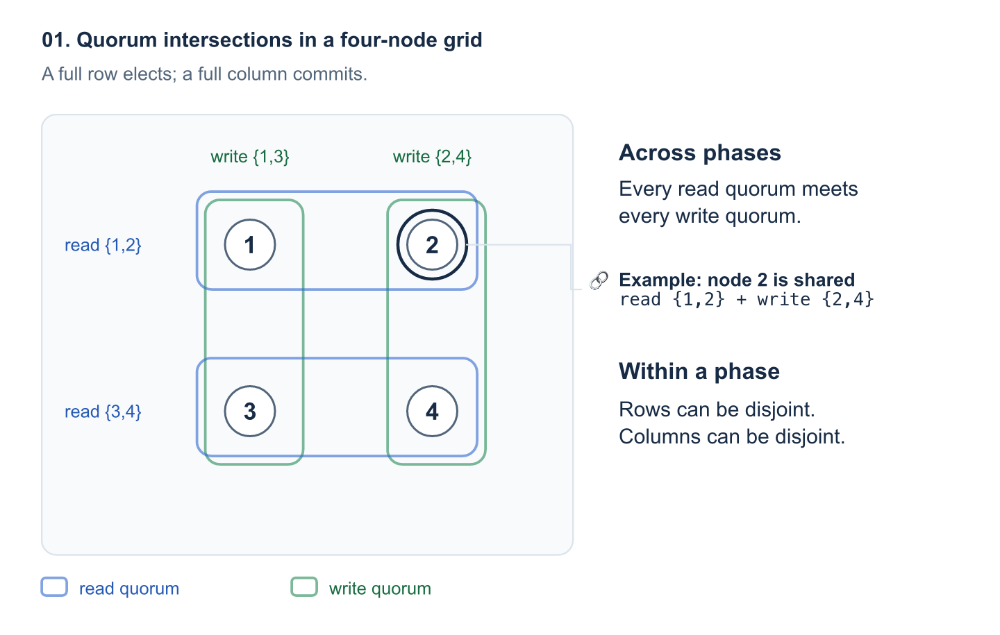
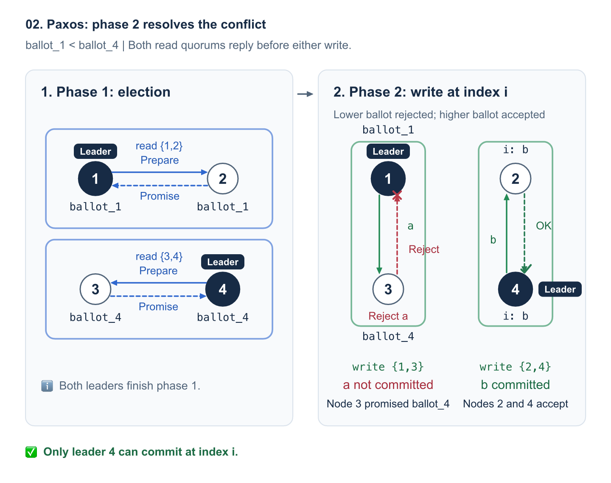
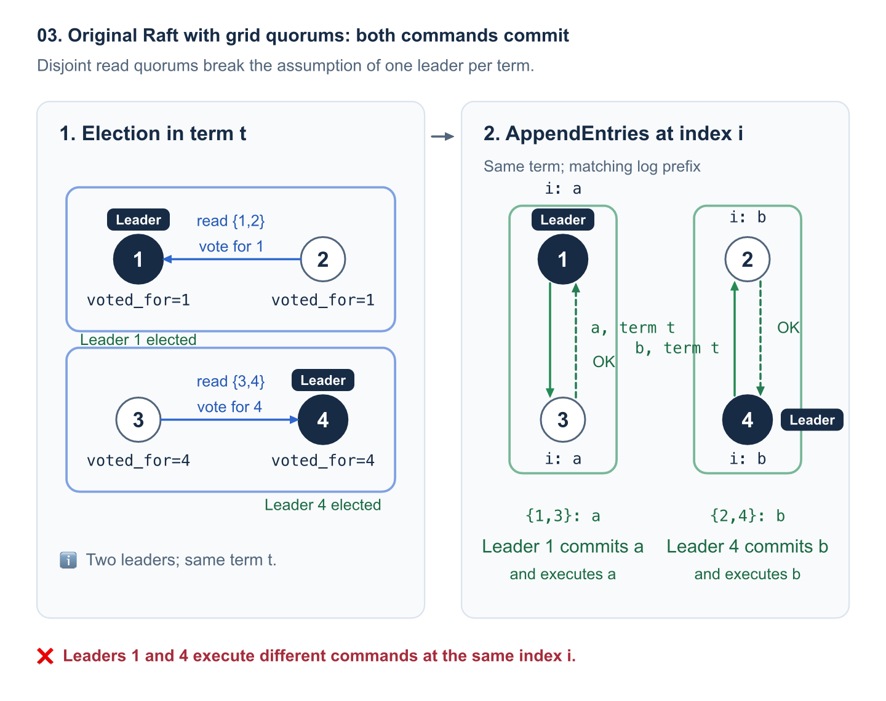
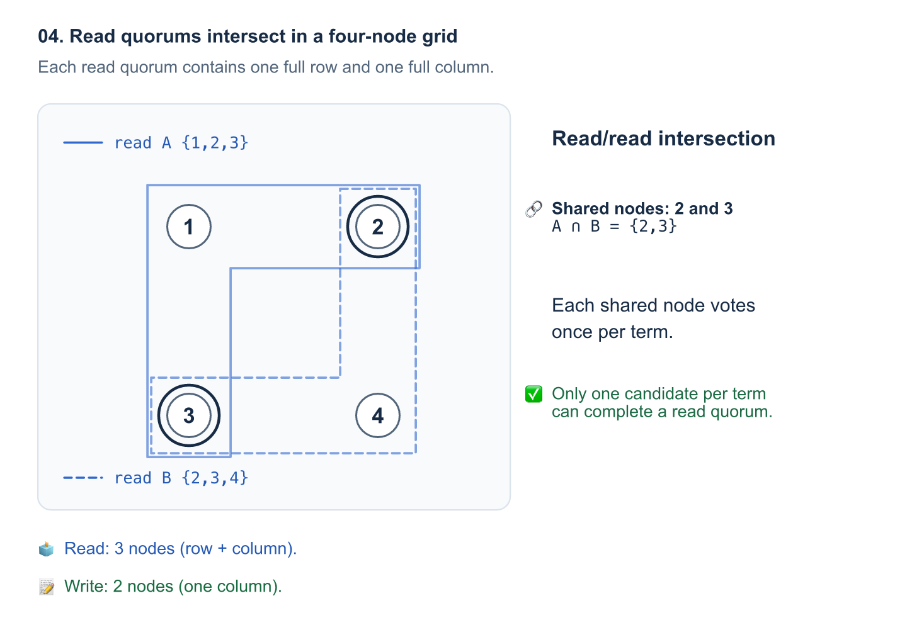
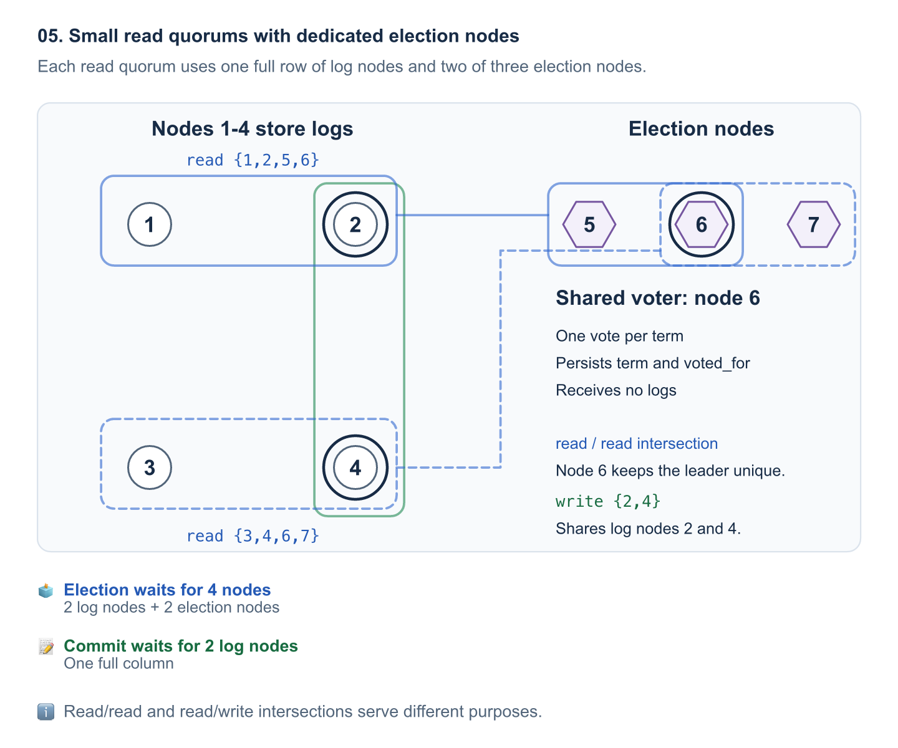
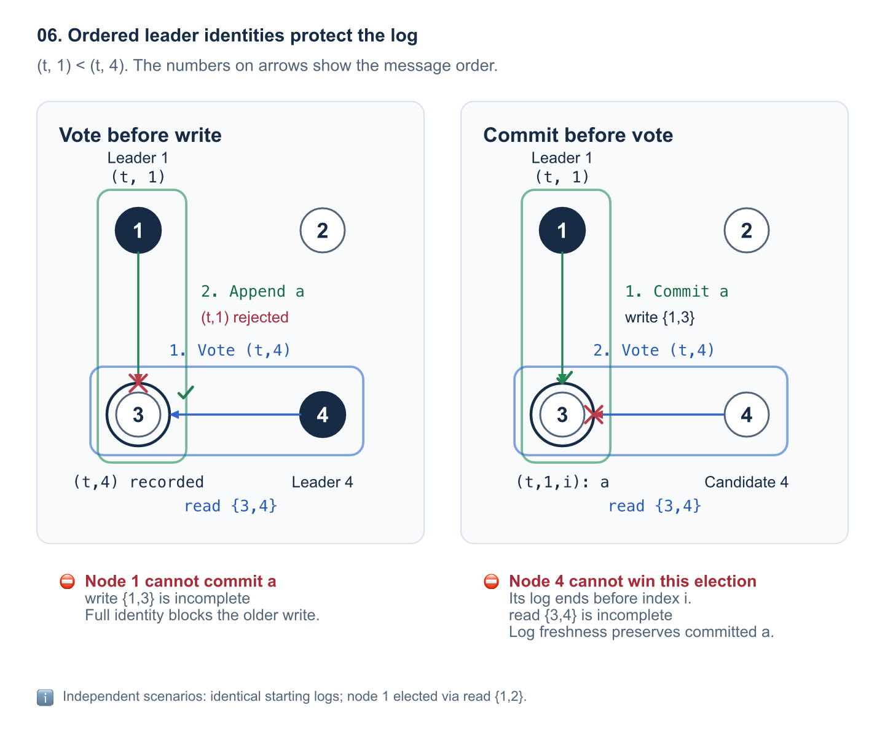
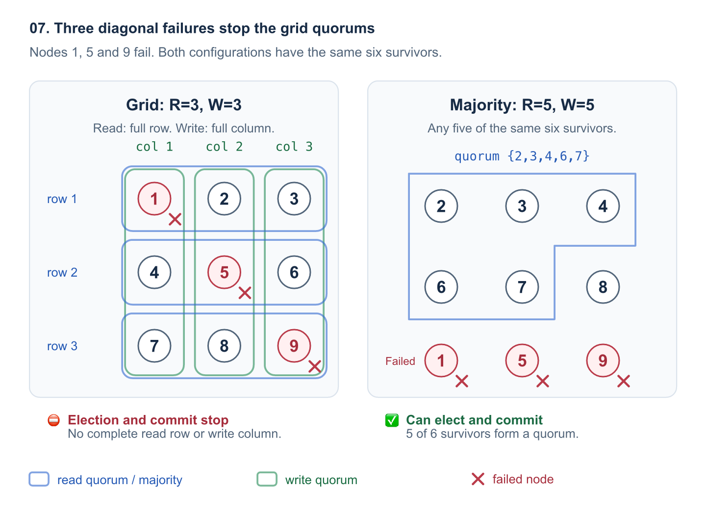
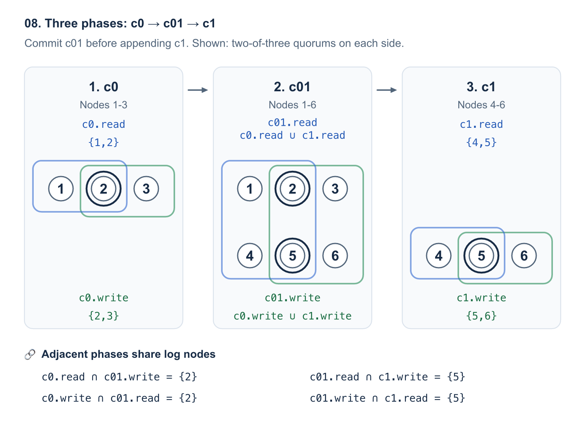

# 从 Flexible Paxos 到 Raft：read-write quorum

标准 Raft 在选举和日志提交时都使用多数派. 如果希望减少日志复制需要等待的节点数, 一个自然的办法是让选举和提交分别使用不同的 quorum.

quorum 指完成一个协议阶段需要取得确认的一组节点. 在本文中, 选举使用的 quorum 称为 read quorum, 提交日志时确认复制完成的 quorum 称为 write quorum.

Raft 确实可以把 read quorum 和 write quorum 分开设置, 但协议仍需要保证每轮选举至多产生一个 leader, 或改用能够区分同一轮不同 leader 的身份规则. 本文从 Flexible Paxos 的做法出发, 说明 Raft 为什么需要这些约束, 以及两种改造方法如何满足约束.

本文默认读者已经了解经典 Paxos 和 Raft, 重点讨论 read quorum 与 write quorum 的交集要求, 以及 Raft 需要满足的 leader 身份约束.

## Flexible Paxos 允许选举和复制使用不同的 quorum

### 任意 read quorum 都必须与任意 write quorum 相交

经典 Paxos 的常见配置在选举和复制阶段都使用多数派 quorum, 因而任意两个 quorum 都有交集. Lamport 的[《Paxos Made Simple》](https://lamport.azurewebsites.net/pubs/paxos-simple.pdf)就采用这种配置.

Flexible Paxos 进一步放宽了交集要求, 把两个阶段的 quorum 分开设置. 第一阶段使用 read quorum 完成选举, 第二阶段使用 write quorum 提交命令. **任意 read quorum 都必须与任意 write quorum 相交, 但 read quorum 之间、write quorum 之间不必相交**.

下面, 我们用 Grid Quorum 举例说明这种配置如何工作.

### 4 个节点排成网格时, 一行选举, 一列复制

放宽 quorum 要求之后, quorum 就有机会小于多数派. 以四节点 Paxos 集群为例, 如果采用行列网格配置, 两个阶段就都可以只等待 2 个节点. 具体来说, 我们可以先把四个节点排成下面的网格:

|        | 第一列 | 第二列 |
| ------ | ------ | ------ |
| 第一行 | node-1 | node-2 |
| 第二行 | node-3 | node-4 |

我们把每一行设为一个 read quorum, 把每一列设为一个 write quorum. 于是, 集群允许使用以下四个 quorum:

- `{1, 2}` 是一个 read quorum.
- `{3, 4}` 是一个 read quorum.
- `{1, 3}` 是一个 write quorum.
- `{2, 4}` 是一个 write quorum.

每一行都与每一列共享一个节点, 所以任意 read quorum 都与任意 write quorum 相交, 满足 Flexible Paxos 的交集要求. 例如, node-1 可以通过 read quorum `{1, 2}` 完成选举, 再通过 write quorum `{1, 3}` 或 `{2, 4}` 提交命令.

在 phase-1, 会有两个 Leader 选出, 但不会破坏共识:

### 两个 leader 都完成第一阶段后, 会在第二阶段产生冲突

两行 read quorum 互不相交, 因此 node-1 可以通过 `{1, 2}` 完成选举, node-4 也可以通过 `{3, 4}` 完成选举. 集群因此可能同时存在两个完成第一阶段的 leader. 之后, 才开始向同一个 index 写入命令, 两个 leader 就会在第二阶段产生冲突, 只有其中一个能够成功.

Paxos 用全局唯一且全序的 ballot 标识每次选举, 也就是任意两个不同的 ballot 都能比较大小. 因而, 节点可以根据 ballot 区分新旧 leader.

当较大 ballot 的 leader 完成第一阶段时, read quorum 中的节点已经承诺拒绝更小 ballot 的写入. 因为任意 write quorum 都与这个 read quorum 相交, 较小 ballot 的 leader 就无法凑齐第二阶段的确认.

举例来说明如何在第二阶段达成共识: 现在假设 node-1 的 ballot 是 `ballot_1`, node-4 的 ballot 是 `ballot_4`, 且 `ballot_1 < ballot_4`. 两个 leader 先完成第一阶段, 再向同一个新的 index `i` 写入不同命令: node-1 准备通过 write quorum `{1, 3}` 提交 `a`, node-4 准备通过 write quorum `{2, 4}` 提交 `b`.

- node-1 复制 `a` 到 node-3 时, node-3 已经在 node-4 的第一阶段承诺 ballot `ballot_4`, 因而拒绝 `ballot_1` 的写入. node-1 第二阶段失败.
- node-4 复制 `b` 到 node-2 时, node-2 承诺的 ballot 是 `ballot_1`, node-4 自己承诺的 ballot 是 `ballot_4`. 可以接受 `ballot_4` 的写入, 因而 node-4 可以完成第二阶段并提交 `b`.

所以, **两个 leader 都先完成第一阶段后, 第二阶段时, 只有较大 ballot 的 leader 能够成功**. 

所以, read quorum 之间可以不相交, 让两个 leader 都完成第一阶段; read quorum 与 write quorum 的交集则把冲突留到第二阶段处理. 在沿用经典 Paxos 其他规则的前提下, Flexible Paxos 因而可以放宽同一阶段的 quorum 交集要求.[Flexible Paxos, §2、§4.1、§5](https://arxiv.org/pdf/1608.06696)

## 但 Raft 不能直接套用 Flexible Paxos 的 quorum 配置

Flexible Paxos 可以减少选举和复制需要等待的节点数, 因此我们也希望把同样的 quorum 设计用到 Raft 中. 从阶段的作用看, Raft 的选举对应 Paxos 的第一阶段, 日志复制对应第二阶段.

例如如果 Raft 能使用行列 Grid quorum 配置, 一个 9 节点集群就可以用一行的 3 个节点选举, 用一列的 3 个节点复制, 将两个阶段需要等待的节点数从多数派的 5 个降到 3 个. 不过, 原版 Raft 要求每个 term 至多选出一个 leader, 不相交的 read quorum 会破坏这个前提, 进而破坏 Raft 的共识. 接下来, 我们用一个四节点例子说明仅有 read quorum 与 write quorum 相交为什么还不够.

### 不相交的 read quorum 可能让同一 index 提交不同命令

为了跟踪例子里的投票, 本文用 `voted_for` 表示节点在当前 term 支持的节点编号.

我们让四个节点运行 Raft, 把 quorum 改成网格: read quorum 是 `{1, 2}` 和 `{3, 4}`, write quorum 是 `{1, 3}` 和 `{2, 4}`. 假设四个节点起初的日志相同, 下一条日志的 index 是 `i`.

现在, 让 node-1 和 node-4 在同一个 term `t` 发起选举. 由于两个 read quorum 没有交集, node-1 可以通过 `{1, 2}` 当选, node-4 也可以通过 `{3, 4}` 当选. 选举结束后, node-2 的 `voted_for` 是 `1`, node-3 的 `voted_for` 是 `4`.

虽然两个节点在同一个 term 都当选了 leader, 原版 Raft 的日志复制规则却不会阻止后续写入. 两个 leader 可以分别执行以下操作:

1. node-1 在 index `i` 写入命令 `a`, 再向 node-3 复制. node-3 虽然投给了 node-4, 但请求的 term 与本地 term 相同, 日志前缀也匹配, 因而接受 `a`. node-1 取得 write quorum `{1, 3}` 的确认, 提交并执行 `a`.
2. node-4 在同一个 index `i` 写入与 `a` 不同的命令 `b`, 再向 node-2 复制. node-2 虽然投给了 node-1, 但请求的 term 与本地 term 相同, 日志前缀也匹配, 因而接受 `b`. node-4 取得 write quorum `{2, 4}` 的确认, 提交并执行 `b`.

结果是, **node-1 和 node-4 在同一个 index `i` 执行了不同命令, 破坏了共识**. 

**原因在于, 原版 Raft 不要求接收节点的 `voted_for` 与请求中的 leader 相同**.[Raft 论文, Figure 2–3](https://raft.github.io/raft.pdf)

### 原因: Raft 的 leader id是偏序关系, 所以必须在选举阶段保证 leader 唯一

原版 Raft 的共识和 Paxos 不同之处在于 Raft 依赖一个前提上: 每个 term 至多选出一个 leader. 本文用 `(term, voted_for)` 表示 leader 身份, 也就是 LeaderId. 

**LeaderId 在 Paxos 里(对应Paxos的 BallotNum)是全序的, 即任意两个可以比较大小, 但在 Raft 里是偏序的**, 最终才需要每个 term 只能有一个 Leader 选出的限制:

Raft 中 LeaderId 偏序关系表现为: 当两个 leader 的 term 不同时, 节点按 term 比较大小; 当 term 和 `voted_for` 都相同时, 两个 leader 相等. 但如果 term 相同、`voted_for` 不同, 两个 leader 就无法比较大小(体现在, 一个节点如果在 term `t` vote给了a节点, 就不能再在 term `t` 把vote给其他节点). 偏序允许出现无法比较的 2 个 LeaderId, 可以参考 OpenRaft 的[偏序比较规则](https://github.com/databendlabs/openraft/blob/728e66bba05c4305dd37016535d1c247a35d2059/openraft/src/vote/leader_id/leader_id_cmp.rs#L9-L27) . 

正是因为这种偏序关系, 即 term 相同时 LeaderId `(term, voted_for)` 可能无法比较大小, 所以为了保证liveness, 在处理 AppendEntries 请求时, 只要AppendEntries中的term和本地的term一样, 就必须允许请求中的`voted_for` 覆盖本地的. 而要保证这个覆盖操作永远正确, 就要求一个 term 必须只能选出一个 Leader. 反之如果有2个leader, 由于LeaderId是偏序的无法确定谁覆盖谁.

当 Raft 使用多数派 read quorum 时, 能够在选举阶段保证 leader 唯一. 任意两个多数派都共享至少一个节点, 所以每个term最多只有一个leader.

但如果两个 read quorum 不相交, 两组 read quorum 就可以在同一个 term 选出两个 leader. 此时, 接收 AppendEntries 的节点仅凭 term, 就无法判断同 term 的两个 leader 谁更新.

> leader 唯一的前提还决定了 Raft 如何识别日志. Raft 用 `(term, index)` 标识日志条目, 这个标识称为 log ID. 因为每个 term 只有一个 leader 创建日志, 原版 Raft 就把同 index、同 term 的条目当成同一条日志.

也正因为在选举阶段已经保证了 leader 唯一, 原版 Raft 的 AppendEntries 才不要求接收节点存储的 `voted_for` 和请求中的不同. 一个节点即使vote给了落选的candidate, 仍然必须接受当选 leader 的复制请求.

因此, quorum 配置能否分离, 关键在于协议如何区分竞争的 leader. Paxos 已经使用全序的 ballot(即LeaderId), 原版 Raft 则依赖每个 term 至多选出一个 leader. 要放宽 Raft 的 read quorum 与 write quorum 配置, 就需要决定是继续维持每个 term 的 leader 唯一, 还是改造协议来区分同 term 的不同 leader.

## Raft 实现 read-write quorum 的两种方法

### 方法一: read quorum 之间也必须有交集

最直接的做法是保留原版 Raft 的协议规则, 同时要求任意两个 read quorum 相交. 这样, 即使选举和提交使用不同的 quorum, 选举阶段仍然能保证每个 term 的 leader 唯一.

要采用方法一, 集群需要满足以下交集条件:

1. 任意 read quorum 都必须与任意 write quorum 相交, 与 Flexible Paxos 的要求相同.
2. 任意两个 read quorum 必须有交集. 由于每个节点在一个 term 内只投一票, 共享的节点就能阻止两个候选节点同时当选.
3. 协议不要求 write quorum 之间相交.

四节点网格也可以满足方法一的条件: 我们把每个 read quorum 扩大为一整行和一整列的并集, write quorum 仍是一整列. 每个 read quorum 包含 3 个节点, 因而任意两个 read quorum 至少共享 2 个节点. 例如, read quorum `{1, 2, 3}` 和 `{2, 3, 4}` 共享 node-2 和 node-3. read quorum 包含一整行, 所以仍与每一列的 write quorum 相交.

也可以要求每个 read quorum 就必须包含超过半数的节点, 即 `R ≥ floor(N/2)+1`.

如果先确定 write quorum size `W`, read quorum size 就必须同时满足 `R ≥ N-W+1` 和 `R ≥ floor(N/2)+1`. 因此, 集群可以选择满足这两个条件的最小 read quorum size: `R = max(N-W+1, floor(N/2)+1)`. 所以, 方法一可以用更大的 read quorum 换取更小的 write quorum.

但是注意, **多数派 quorum 仍然是可用性最高的方案**: 按节点数量配置 quorum 时, 较大的 read quorum 会降低重新选举的故障容忍度. 例如, 五节点集群采用 `R=4,W=2`, 日志提交只需取得 2 个节点的确认, 重新选举则需要 4 个节点投票. 如果 leader 和另一个节点同时故障, 集群只剩 3 个节点, 少于选举所需的 4 个节点, 因而无法选出新 leader. 五节点多数派配置采用 `R=3,W=3`, 两个节点故障后剩余的 3 个节点仍满足 read quorum size 的要求.

#### 专门的选举节点只投票, 不接收日志

方法一也可以通过少量专门的选举节点, 让所有 read quorum 相交. 这里的选举节点是一种新增角色: 选举节点只参与投票, 持久化 term 和 `voted_for`, 平时不接收日志, 也不竞选 leader.

我们可以规定, 每个 read quorum 都必须取得选举节点中的多数票. 由于任意两个多数派都共享至少一个选举节点, 而每个选举节点在同一个 term 内只投一票, 不同的 read quorum 就无法在同一个 term 选出两个 leader.

不过, 选举节点只负责保证 leader 唯一. read quorum 还必须包含保存日志的节点, 并在保存日志的节点上与每个 write quorum 相交. 保存日志的节点继续按 Raft 的日志新旧规则投票, 才能保证当选 leader 保留已提交日志.[Raft 论文, §5.4.1、§5.4.3](https://raft.github.io/raft.pdf)

例如, 我们可以把 4 个保存日志的节点排成 `2×2` 网格, 再增加 3 个选举节点. 每个 read quorum 包含网格中的一整行和任意 2 个选举节点, 每个 write quorum 则包含网格中的一整列. 任意两个 read quorum 至少共享一个选举节点, 任意 read quorum 与任意 write quorum 也共享一个保存日志的节点. 因而, 这个 7 节点集群选举只需 4 个节点确认, 提交只需 2 个节点确认.

这种配置依靠 read quorum 的组成规则保证交集. 如果希望 read quorum 之间也可以不相交, 就需要进一步修改 leader 身份及相关规则.

### 方法二: 投票、日志和复制使用全序的 leader 身份

另一种做法是让协议能够区分同 term 的不同 leader. 方法二把 leader 身份定义为全局唯一、全序的 `(term, voted_for)`: 节点先比较 term, term 相同时再比较 `voted_for`. 因而, 即使两个 leader 的 term 相同, 节点也能比较两个完整身份的大小. 每个候选节点在每次竞选时都必须使用新的 leader 身份, 同一个身份只属于一个候选节点.

为了让身份比较真正约束选举和写入, 投票、复制、日志匹配和提交都必须使用完整的 leader 身份. 协议需要相应调整3项规则:

1. 接收投票请求的节点需要持久化已经接受的最大 leader 身份, 并拒绝身份小于本地记录的投票请求. 候选节点的日志还须至少与接收节点一样新. 如果接收节点接受了更大的身份, 就持久化更新本地记录, 即使两个身份属于同一个 term.
2. 接收 AppendEntries 的节点也需要比较完整 leader 身份, 拒绝身份小于本地记录的请求. 接受更大身份时, 接收节点持久化更新本地记录, 随后拒绝较小身份的写入.
3. 日志条目需要记录创建条目的完整 leader 身份, 因而 log ID 扩展为 `(term, voted_for, index)`. log ID 中的 `voted_for` 属于创建条目的 leader, 不随接收节点当前的投票记录改变. 选举比较最后一条日志的新旧时, 节点先比较 log ID 中的 leader 身份, 身份相同时再比较 index. AppendEntries 检查前缀、识别已有条目和冲突条目时, 接收节点也必须使用完整 log ID.

按照完整 leader 身份处理请求后, 节点就能区分同 term 的不同 leader, 并在处理 AppendEntries 时拒绝较小 LeaderId 的后续写入. 不再要求选举阶段每个 term 只能有一个 leader.

因此, 方法二可以把交集要求放宽到 Flexible Paxos 的程度: 任意 read quorum 必须与任意 write quorum 相交, 而 read quorum 之间不必相交.

为了看清方法二如何处理冲突, 我们仍使用四节点网格: read quorum 是 `{1, 2}` 和 `{3, 4}`, write quorum 是 `{1, 3}` 和 `{2, 4}`. 假设四个节点在 term `t` 开始前的日志相同, node-1 和 node-4 分别使用 `(t, 1)` 和 `(t, 4)` 竞选, node-1 准备在下一个 index `i` 提交命令 `a`.

按照完整身份的比较规则, `(t, 1) < (t, 4)`. 节点一旦接受并记录 `(t, 4)`, 就会拒绝 `(t, 1)` 的请求. 我们再分别考察两种消息顺序, 就能看到结果与直接套用网格 quorum 时不同:

- 如果 node-3 先投给 node-4, node-3 就会持久化记录 `(t, 4)`, 随后拒绝 node-1 以较小身份 `(t, 1)` 发来的 AppendEntries. 因而, node-1 无法取得 write quorum `{1, 3}` 的确认.
- 如果 node-1 先通过 `{1, 3}` 提交 `a`, node-3 就已经持有 `a`. 此时 node-4 的日志仍停在 index `i` 之前, 所以 node-3 会拒绝 node-4 的投票请求. node-4 若要通过 read quorum `{3, 4}` 当选, 就必须先取得足够新的日志, 并保留已提交的 `a`.

另外, Grid quorum 的故障容忍度取决于能否保留完整的行和列. 以九节点的 `3×3` 网格为例, 每个 read quorum 是一整行的 3 个节点, 每个 write quorum 是一整列的 3 个节点. 如果 3 个故障节点分别落在网格的对角线上, 每行和每列就都会缺少一个节点. 集群虽然还剩 6 个节点, 却无法凑齐任何一行或一列, 因而选举和日志提交都会停止. 而九节点如果用多数派配置只需 5 个节点确认, 这样损坏三个节点后, 6 个节点仍满足选举和提交的数量要求.

从实现上看, 方法二需要把 **log ID 从 `(term, index)` 扩展为 `(term, voted_for, index)`**, 投票记录和复制请求也要携带完整 leader 身份. 因而, 协议的多个环节都需要配合身份规则的变化.

OpenRaft 的实现可以作为这部分改造的参考. OpenRaft 已有[完整 leader 身份的投票与持久化](https://github.com/databendlabs/openraft/blob/728e66bba05c4305dd37016535d1c247a35d2059/openraft/src/engine/handler/vote_handler/mod.rs#L101-L155)、[完整 log ID 的前缀检查](https://github.com/databendlabs/openraft/blob/728e66bba05c4305dd37016535d1c247a35d2059/openraft/src/engine/handler/following_handler/mod.rs#L120-L139)和[当前 leader 身份的提交检查](https://github.com/databendlabs/openraft/blob/728e66bba05c4305dd37016535d1c247a35d2059/openraft/src/engine/handler/replication_handler/mod.rs#L230-L244). 

## Client Read 可以通过 write quorum 确认 Leadership

Raft 的客户端读 Linearizable Read 要求返回结果反映读请求开始前已经完成的写入. 为了满足 Linearizable Read 的要求, Raft 可以使用 ReadIndex: leader 确认自身的 Leadership, 并等待状态机应用完本次读所需的已提交日志.

**本文的两种方法都可以使用任意一个 write quorum, 完成 ReadIndex 所需的 Leadership 确认.**

用 ReadIndex 处理读请求时, leader 按以下步骤处理, 和标准的 Raft 的不同只有"只使用 write quorum":

1. leader 收到读请求时, 把当前提交位置记录为本次读请求的 `read_index`.
2. leader 选择一个 write quorum 作为本次读请求的心跳确认集合. leader 为本次读请求发起一轮新的心跳, 等待选中的 write quorum 全部确认当前 leader 身份. 心跳携带本次确认轮次的标识, leader 只统计与本次确认轮次对应的回复.
3. leader 等待本地状态机应用完 index 不超过 `read_index` 的已提交日志, 再读取状态机并返回结果.[etcd/raft 的 ReadIndex 接口与应用要求](https://github.com/etcd-io/raft/blob/v3.6.0/node.go#L199-L205)

心跳沿用选举和复制的 LeaderId 比较规则: 方法一保证每个 term 至多一个 leader, 接收节点按 term 拒绝旧 leader 的心跳. 方法二允许同 term 的不同 leader, 因而心跳必须携带并比较完整的 `(term, voted_for)` 身份, 接收节点也要拒绝较小LeaderId的心跳.

write quorum 足以完成 Leadership 确认, 原因是任意 write quorum 都与任意选举 read quorum 相交. 假设更大身份的 leader 已在读请求开始前当选, 新 leader 的 read quorum 与本次心跳使用的 write quorum 至少共享一个节点. 共享节点已经接受更大的 leader 身份, 因而会拒绝旧 leader 的心跳. 因此, 旧 leader 无法收齐本次 write quorum 的全部确认, 也就无法通过 ReadIndex 返回过期的读结果.

例如, 五节点集群采用 `R=4,W=2` 的 quorum size 配置时, 任意 2 个确认节点都与任意 4 个节点组成的选举 quorum 相交, 因而 ReadIndex 的心跳确认只需等待 2 个节点.

## read-write quorum 下的成员变更

前面的两种方法都先假设参与协议的节点和 quorum 规则固定. 当集群增加或移除节点时, quorum 的成员也会随之变化, 因此还需要考虑配置切换期间的交集. 下文的配置切换过程适用于保存日志的节点; 不接收日志的选举节点还需要单独设计配置同步规则.

成员配置规定参与协议的节点和 quorum 条件. 下文用 `c0` 表示旧配置, `c01` 表示过渡的 joint 配置, `c1` 表示新配置. 成员变更按 `c0 → c01 → c1` 推进, 而切换期间不同节点可能正在使用不同的配置. 在 `c01` 中, 选举必须同时满足 `c0` 和 `c1` 各自的 read quorum, 提交必须同时满足 `c0` 和 `c1` 各自的 write quorum.

### 先提交 joint 配置, 再启用新配置

Raft 通过日志传播成员配置, 记录成员配置的日志条目称为配置日志. 每个节点以本地最新一条配置日志中的成员配置为准. 也就是说, 配置日志一旦追加到本地日志中, 节点就开始使用对应的配置, 不必等到配置日志提交.

Raft 中 leader 按以下顺序推进成员变更:

1. leader 先追加并复制 `c01` 配置日志. 各节点将 `c01` 配置日志追加到本地日志后, 就开始使用 `c01`.
2. 等 leader 按 `c01` 的 write quorum 提交 `c01` 配置日志后, leader 才能追加并复制 `c1` 配置日志. 各节点将 `c1` 配置日志追加到本地日志后, 就开始使用 `c1`.
3. 最后, leader 按 `c1` 的 write quorum 提交 `c1` 配置日志, 完成成员变更.

成员变更期间, 不同节点可以暂时分别使用 `c0` 和 `c01`, 也可以分别使用 `c01` 和 `c1`. leader 必须先提交 `c01` 配置日志, 才能追加 `c1` 配置日志. 同时, 投票时的日志新旧比较和提交规则保证后续 leader 保留已提交的配置日志. 因此, `c0` 和 `c1` 不能同时独立作出决定.[Raft 论文, §6、Figure 11](https://raft.github.io/raft.pdf)

所以, 检查成员变更的 quorum 交集时, 我们只需考虑 `c0` 与 `c01`、`c01` 与 `c1` 两组相邻配置. 每组中, 每一方的每个 read quorum 都必须与另一方的每个 write quorum 相交. 如果采用方法一, 还需要保证两个相邻配置之间的任意 read quorum 相交, 配合每个 term 只投一票来保证 leader 唯一. 方法二已经使用完整 leader 身份区分竞争的 leader, 因而只要求 read quorum 与 write quorum 相交.

### joint 配置分别合并新旧配置的 read quorum 和 write quorum

为了满足相邻配置之间的交集要求, `c01` 需要分别合并 `c0` 和 `c1` 的 read quorum 和 write quorum. 下文用 `c0.read`、`c0.write` 表示 `c0` 的一个 read quorum 和一个 write quorum, `c01` 和 `c1` 也使用相同记法. 具体来说, `c01.read` 包含 `c0.read` 和 `c1.read`, `c01.write` 包含 `c0.write` 和 `c1.write`.

通过 `c01`, `c0` 和 `c1` 各自的交集关系就能在过渡期间继续成立. 因而, `c0` 与 `c1` 的成员可以完全不同, 两者的 quorum 不要求直接相交. **成员变更的安全性依赖 `c01` 的 quorum 构造, 也依赖 `c01` 先提交、`c1` 再生效的顺序**.

## 总结

Raft 的 read-write quorum 设计, 需要让 quorum 交集与 LeaderId 规则共同保护已提交日志. 方法一通过 read quorum 两两相交, 保留每个 term 至多一个 leader 的约束; 方法二通过全序的 LeaderId 和配套的投票、日志匹配、复制及提交规则, 允许 read quorum 之间不相交. 在固定配置内, 两种方法都要求任意 read quorum 与任意 write quorum 相交. ReadIndex 和成员变更也必须满足所选方法的身份规则与交集要求. 最终的 quorum 配置需要兼顾提交等待开销、故障后的可用性和协议改造成本.
