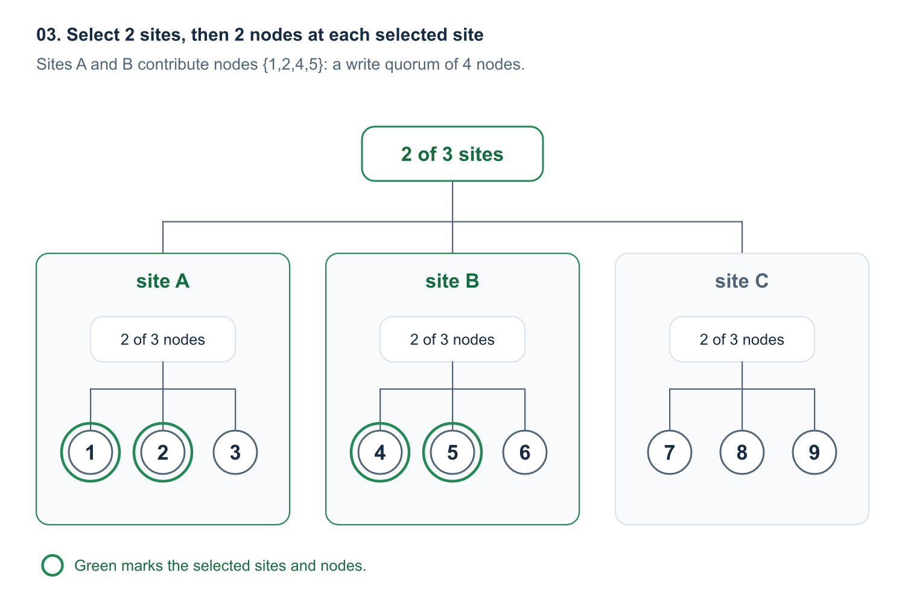
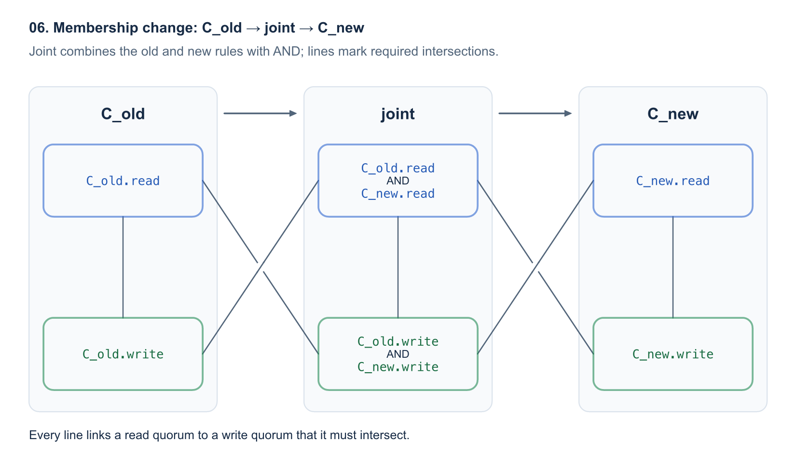
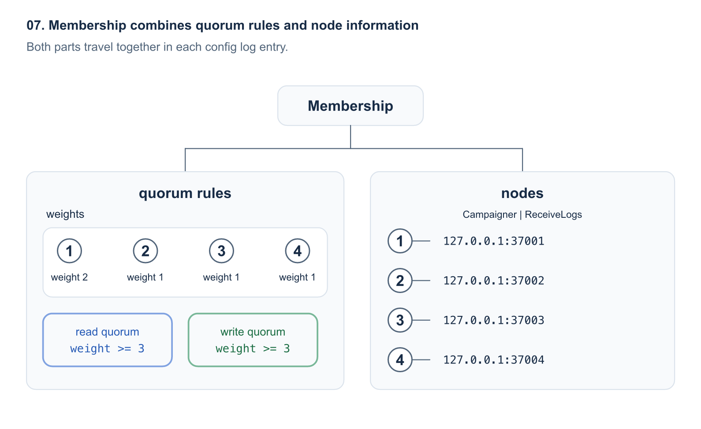

[OpenRaft][repo-openraft] 最近加入了自定义 membership, 让应用决定 election 和 append entries 使用的 quorum, 而不只使用 majority.

例如:

- 4 个 node 的集群可以设置 `read quorum = 3`, `write quorum = 2`. election 需要 3 个 vote, append entries 得到 2 个 node 的复制确认后即可 commit, 比 majority 少等 1 个 node.
- 9 个 node 分在 3 个机房时, 可以要求任意 2 个机房各有 2 个 node 完成日志复制, 4 份确认就达到 write quorum 并 commit, 也比 majority 少等 1 份.
- 等等...

read quorum, write quorum 和 node 地址一起组成集群的 membership. 应用可以选择 OpenRaft 现成的 membership, 也可以实现自己的类型.

## 1. election 和 append entries 可以使用不同的 quorum

node `{1,2,3,4}` 采用 `read quorum = 3`, `write quorum = 2` 时, 2 份日志复制确认就能让 1 条 log entry commit. 例如, leader 1 收到 `foo=1` 的 client write, 在本地保存 log entry, 并通过 append entries 复制到 node 2. node `{1,2}` 构成这条 log entry 的 **write quorum**, 足以让它 commit.

election 时, candidate 通过 request vote 收集 3 个 vote. 例如, node 1 获得自己和 node 3, 4 的 vote, 就可以赢得 election. node `{1,3,4}` 构成这次 election 的 **read quorum**. 这里的 read 指 voter 处理 vote request 时检查 candidate 的日志新旧.

```text
election: read quorum
+---------------------------------+
| node 3    node 4                |
|                   +-------------+-------------+
|                   |   node 1    |   node 2    |
+-------------------+-------------+             |
                    +---------------------------+
                    append entries: write quorum
```

其余 node 仍会接收 append entries.

membership 保存 read quorum 和 write quorum. node 地址也保存在 membership 中.

election 的完整判定规则见 [OpenRaft 文档][election-quorum]. Paxos 中类似的 quorum 分离设计见 [Flexible Paxos][flexible-paxos].

## 2. 5 种常用 membership 可以直接使用

要按副本数, node 权重或机房定义 quorum, 可以直接使用 [`openraft-membership`][provided-memberships] 提供的 5 种实现.

### ThresholdMembership: 按 node 数定义 quorum

例如, 一个 `ThresholdMembership` 可以定义 cluster 的 node 为 `{1,2,3,4}`, 并设置 `write_size = 2`. 此时任意 2 个 node 保存 log entry 后就达到 write quorum, read quorum 自动取 `4 - 2 + 1 = 3`. 集群 election 时需要任意 3 个 node.

### WeightedMembership: 按 node 权重定义 quorum

定义一个 `WeightedMembership`, 包含 node `{1,2,3,4}`, 权重为 `{1:2, 2:1, 3:1, 4:1}`. 总权重为 5. write weight 设为 3, read weight 自动取 `5 - 3 + 1 = 3`.

任意一组 node 的权重之和达到 3, 就能构成 read quorum 或 write quorum. 例如, node `{1,2}` 的权重为 `2 + 1 = 3`, 可作为 election 的 read quorum. node `{2,3,4}` 的权重为 `1 + 1 + 1 = 3`, 可作为 append entries 的 write quorum, 支持 commit.

```text
read quorum: weight 2 + 1 = 3
+---------------------------------------+
| node 1 (weight 2)                     |
|                   +-------------------+-------------------+
|                   | node 2 (weight 1) | node 3 (weight 1) |
+-------------------+-------------------+                   |
                    |                     node 4 (weight 1) |
                    +---------------------------------------+
                    write quorum: weight 1 + 1 + 1 = 3
```

node `{1,2}` 同样可以构成 write quorum. 将 node 1, 2 放在机房 A, node 3, 4 放在机房 B. 即使机房 B 离线, 机房 A 仍能完成 election 和 commit.

加权 quorum 的背景可参考 [Weighted Voting for Replicated Data][weighted-voting].

### HierarchicalMembership: 可按机房, 机架分层定义 quorum

对于 9 个 node 分在 3 个机房的场景, 我们希望任意 2 个机房各有 2 个 node 确认 append entries, 就达到 write quorum. 例如, `foo=1` 等机房 A 的 node 1, 2 以及机房 B 的 node 4, 5 保存后即可 commit, 共等 4 份确认. 这时, 我们就可以使用下面的 2 层树形结构定义 quorum:



机房 A 整体离线后, 可以改用机房 B 的任意 2 个 node 和机房 C 的任意 2 个 node. election 的 read quorum 同样要求 2 个机房各有 2 个 vote.

`HierarchicalMembership` 把 "机房-node" 树保存下来: 集群层需要 2 个机房, 每个机房内部需要 2 个 node. 如果你需要一个 "机房-机架-交换机-服务器 node" 的多层树形 quorum 设计, 也是可以的.

### GridMembership: read quorum 取整行, write quorum 覆盖每行

Grid 的一个例子是: 9 个 node 的 3x3 网格, 用任意 1 行构成 read quorum, 每行取 1 个 node 构成 write quorum. node 按 3 行排列:

```text
election: read quorum
+-------------------------+
|   [1]      2       3    |
+-------------------------+
     4      [5]      6
     7       8      [9]

[n] = node n in the write quorum (append entries)
```

例如, election 时, candidate node 1 可以收集第 1 行 `{1,2,3}` 的 3 个 vote 赢得 election. append entries 复制 `foo=1` 时, 则可以等 node `{1,5,9}` 各保存 1 份 log entry 后 commit.

`GridMembership` 的 read quorum 包含完整的 1 行, write quorum 包含每行至少 1 个 node. 因此, 任意 1 行的 election 都会遇到保存这条 log entry 的某个 node. 例如, 只剩 `{1,2,3,5,9}` 在线时, 第 1 行仍能形成 read quorum, node `{1,5,9}` 仍能形成 write quorum.

更多 grid quorum 的设计见 [Flexible Paxos 的 grid quorums 章节][flexible-paxos-grid].

### ExplicitMembership: 直接列出 quorum

如果 quorum set 的设计比较特殊的话, 那么我们可以直接列出这个 quorum set 里面有哪些 quorum, 来定义它的集群. 例如, 9 个 node 的 cluster 可以定义如下的 read quorum 和 write quorum, 只要 read quorum 和 write quorum 之间都有交集即可:

```text
read quorum    write quorum
{1,2}          {1,2,9}
{1,3}          {1,3,9}
{2,3}          {2,3,9}
```

例如, 我们的 election 可以通过 `{1,2}` 完成, 然后 log `foo=1` 通过复制到 node 1, 3, 9 后即可 commit.

`ExplicitMembership` 直接保存这些 node 组合. 应用可以分别列出 read quorum 和 write quorum.

## 3. 让 KV 按 node 权重设置 read quorum 和 write quorum

下面我们展示一个例子, 让 KV 存储服务按 node 权重形成 quorum: 在 [`TypeConfig`][example-type-config] 中选择 `WeightedMembership` 和 `WeightedChange`. [加权 KV 示例][example-weighted] 的关键是以下 2 个 associated type: 前者定义 quorum, 后者表示修改权重, 添加 learner 等操作.

```rust
use openraft_membership::{WeightedChange, WeightedMembership};

openraft::declare_raft_types!(
    pub TypeConfig:
        D = types_kv::Request,
        R = types_kv::Response,
        Node = openraft::NodeInfo,
        Membership = WeightedMembership<Self::NodeId, Self::Node>, // 定义 read quorum 和 write quorum
        MembershipEdit = WeightedChange<Self::NodeId, Self::Node>, // 修改权重或增删 node
);
```

示例先初始化只包含 node 1 的集群, node 1 的权重和 write weight 都为 1. 下面的 `raft` 是按 `TypeConfig` 创建的 Raft 实例:

```rust
use std::collections::BTreeMap;

use openraft::NodeInfo;

let node = NodeInfo::new("127.0.0.1:37001", "127.0.0.1:36001");
let nodes = BTreeMap::from([(1, node)]);
let weights = BTreeMap::from([(1, 1)]);
let membership = WeightedMembership::new(weights, 1, nodes)?;
raft.initialize(membership).await?;
```

接着, `add_learner()` 加入 node 2, 3, 4 后, `change_membership()` 把 4 个 node 都设为 voter, 并设置权重和 write weight:

```rust
let weights = BTreeMap::from([(1, 2), (2, 1), (3, 1), (4, 1)]);
let change = WeightedChange::weights(weights);
let change = change.with_write_weight(3);
raft.change_membership(change, false).await?;
```

之后是使用这个集群的写入测试: [示例的进程测试][example-test]先发送 `foo=1` 的 client write, 再停掉 node 3, 4. node 1 保持 leader, 继续 commit `foo=2`; node 2 读到新值, node 1 也完成 linearizable read.

### 实现自己的 membership

如果应用要定义自己的 membership 和 quorum set, 例如 "node 1, 2, 3 中任意 2 个 node, 加上备份 node 9" 这个 write quorum, 我们可以实现一个自己的 `MyMembership`, 实现 [`RaftMembership`][trait-membership]:

| 方法 | 在这个例子中的行为 |
| --- | --- |
| `get_node(node_id)`, `node_ids()` | `get_node(&9)` 返回备份 node 9 的地址和 role; `node_ids()` 列出 1, 2, 3, 9. |
| `read_quorum_set()` | 返回 read quorum set: 主站 node 1, 2, 3 中任意 2 个 node. |
| `write_quorum_set()` | 返回 write quorum set: 主站任意 2 个 node, 加上备份 node 9. |
| `supports_direct_transition_to(other)` | 主站换成 4, 5, 6 时返回 `false`, 要求先经过 joint. |
| `joint_with(goal)` | 构造 joint config: election 收旧, 新主站各 2 个 vote; append entries 需要旧, 新主站各 2 份日志和 node 9 的确认. |

`MyMembership` 还需指定 `NodeId`, `Node`, `QuorumSet` 和 node 迭代器 `Iter` 这 4 个 associated type, 例如可以用 `u64` 标识 node, 用 [`NodeInfo`][node-info] 保存地址.

完成上面的实现后, write quorum set 的 [`QuorumSet::is_quorum()`][trait-quorum-set] 应该在收到输入 `{1,2,9}` 时返回 `true`, 收到 `{1,2}` 时返回 `false`; `ids()` 则应该给出 1, 2, 3, 9. [`QuorumIntersection::intersects_with()`][trait-quorum-intersection] 判断每个 read quorum 是否都与每个 write quorum 相交.

对应的 `MyEdit` 用于定义可对 `MyMembership` 进行哪些修改, 也完全由应用定义. 例如可以表示 "添加 learner 4", "移除 node 3 的 voter 身份" 等操作. `MyEdit` 实现了 [`RaftMembershipEdit<MyMembership>`][trait-edit], 并提供 3 个方法:

| 方法 | 在这个例子中的行为 |
| --- | --- |
| `apply(membership, retain)` | 将 node 3 降为 learner 时, `retain = true` 保留 node 3, `false` 移除 node 3; 返回变更后的 membership. |
| `add_learner(node_id, node)` | 生成 "把 node 4 及其地址加入为 learner" 的操作. |
| `make_uniform()` | 生成 "使用目标主站 4, 5, 6 及备份 node 9" 的操作, 结束 joint. |

最后, 将 `TypeConfig::Membership` 设为 `MyMembership`, 将 `TypeConfig::MembershipEdit` 设为 `MyEdit`.

[自定义操作测试][test-custom-edit]直接使用 `ThresholdMembership`. 应用也可以照这样复用现成 membership, 仅实现自己的 edit.

## 4. 一个 Membership 包含的信息

一个 Membership 一般来说要包含:

1. node 列表: 说明集群中都包含哪些 node, 这些 node 也可能有对应的角色 (例如有些是 learner, 只接收日志).
2. Quorum set 的定义: 定义 read quorum 和 write quorum 分别是什么.

当然, 也可以不区分 read 和 write, 都用同样的一个 quorum 定义就行. 就像 OpenRaft 里面默认提供的 Membership 实现, 就是一个最简单的不区分 read 和 write 的 Majority Quorum 实现.

### node 信息: 确定 node 地址和角色

当 2 个 node 需要通信时, 就用 Membership 定义的 node 信息去查找某个 node 对应的地址. 当然, 它也可以包含其他东西, 例如一个 node 所在的机房或者是其他路由信息, 这些信息一般都是应用自己定义的.

同时, 为了标识每个 node, Membership 也需要定义一个 NodeId, NodeId 一般可以用整数去表示.

membership 的 `get_node(&4)` method 可以返回下面这样的 [`NodeRef`][node-ref]:

```rust
use openraft::NodeInfo;
use openraft::membership::{NodeRef, NodeRole};

let metadata = NodeInfo::new("127.0.0.1:37004", "127.0.0.1:36004");
let learner = NodeRef {
    node: &metadata,
    role: NodeRole::ReceiveLogs,
    is_read_voter: false,
    is_write_voter: false,
};
```

`ReceiveLogs` 这个 role 允许 node 4 接收 append entries. 2 个 voter 标志由 read quorum set 和 write quorum set 的 `ids()` 决定; 这里都为 `false`, 所以 node 4 当前只是 learner.

如果还希望 node 4 自行发起 election, 可以给它 [`NodeRole::Campaigner | NodeRole::ReceiveLogs`][node-role]. `Campaigner` 决定能否自行发起 election; voter 的 role 即使只有 `ReceiveLogs`, 也仍会 vote. 如果 commit 需要 node 4 的确认, node 4 就必须接收并保存对应的 log entry.

### read quorum 和 write quorum

另外一个 membership 里面比较重要的信息就是 quorum 的定义: 其中 read quorum 用于 election, write quorum 用于 append entries 并 commit 日志.

每个 read quorum 都必须与每个 write quorum 相交, 才能让任何 election 都遇到保存已 commit 日志的 node. 例如, read quorum 为 `{1,3,4}`, write quorum 为 `{1,2}`, 这 2 组 node 共享 node 1.

### membership change: 分别对 read quorum 和 write quorum 做 joint

从旧 config `C_old` 切换到新 config `C_new` 时, 先进入 [joint config][raft-joint-consensus]. joint 的 read quorum 同时满足旧, 新的 read quorum 规则, write quorum 同时满足旧, 新的 write quorum 规则.

`C_old.read`, `C_old.write` 分别表示旧 config 的 read quorum, write quorum 规则; `C_new.read`, `C_new.write` 表示新 config 的对应规则.

方框之间的连线表示: 两端按规则选出的任意 read quorum 和 write quorum 都必须相交.



### membership 的构成: quorum 和 node 信息

membership 把 read quorum, write quorum 与 node 地址, role 一起记录为 config log entry. 其他 node 复制到这份 config 时, 就同时得到 node 地址, read quorum 和 write quorum.

4 个 node 的加权示例中, 最终 membership 保存了以下内容:



membership 包含这 2 部分: quorum 保存 node 权重, read weight 和 write weight, nodes 保存 node 1, 2, 3, 4 的地址和 role.

[provided-memberships]: https://github.com/databendlabs/openraft/blob/43537dd5b7d247be49c10163cff09700915c0f60/membership/src/docs.md
[example-weighted]: https://github.com/databendlabs/openraft/tree/43537dd5b7d247be49c10163cff09700915c0f60/examples/raft-kv-memstore-weighted-membership
[example-test]: https://github.com/databendlabs/openraft/blob/43537dd5b7d247be49c10163cff09700915c0f60/examples/raft-kv-memstore-weighted-membership/tests/cluster/test_weighted_membership.rs
[trait-membership]: https://github.com/databendlabs/openraft/blob/43537dd5b7d247be49c10163cff09700915c0f60/openraft/src/membership/raft_membership.rs
[trait-edit]: https://github.com/databendlabs/openraft/blob/43537dd5b7d247be49c10163cff09700915c0f60/openraft/src/membership/raft_membership_edit.rs
[test-custom-edit]: https://github.com/databendlabs/openraft/blob/43537dd5b7d247be49c10163cff09700915c0f60/tests/tests/membership/t41_custom_membership_edit.rs
[node-info]: https://github.com/databendlabs/openraft/blob/43537dd5b7d247be49c10163cff09700915c0f60/openraft/src/node.rs
[node-role]: https://github.com/databendlabs/openraft/blob/43537dd5b7d247be49c10163cff09700915c0f60/openraft/src/membership/node_role.rs
[node-ref]: https://github.com/databendlabs/openraft/blob/43537dd5b7d247be49c10163cff09700915c0f60/openraft/src/membership/node_ref.rs
[election-quorum]: https://github.com/databendlabs/openraft/blob/43537dd5b7d247be49c10163cff09700915c0f60/openraft/src/docs/protocol/election_quorum.md
[example-type-config]: https://github.com/databendlabs/openraft/blob/43537dd5b7d247be49c10163cff09700915c0f60/examples/raft-kv-memstore-weighted-membership/src/lib.rs#L20
[trait-quorum-set]: https://docs.rs/quorum-set/0.6.0/quorum_set/trait.QuorumSet.html#tymethod.is_quorum
[trait-quorum-intersection]: https://docs.rs/quorum-set/0.6.0/quorum_set/trait.QuorumIntersection.html#tymethod.intersects_with
[flexible-paxos]: https://arxiv.org/abs/1608.06696
[weighted-voting]: https://www.cs.cornell.edu/courses/cs614/2004sp/papers/Gif79.pdf
[flexible-paxos-grid]: https://arxiv.org/html/1608.06696v1#S4.SS3
[raft-joint-consensus]: https://raft.github.io/raft.pdf#page=10
