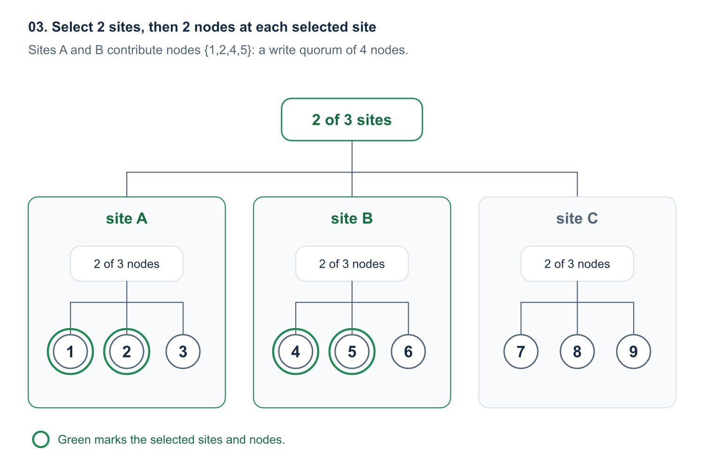
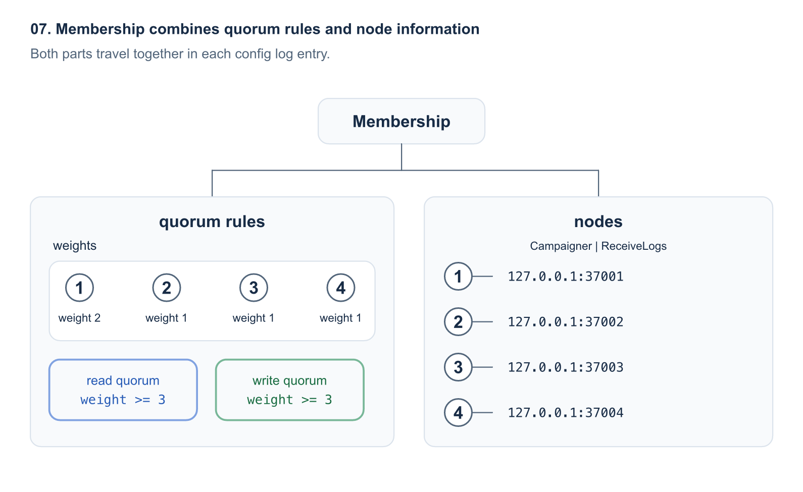
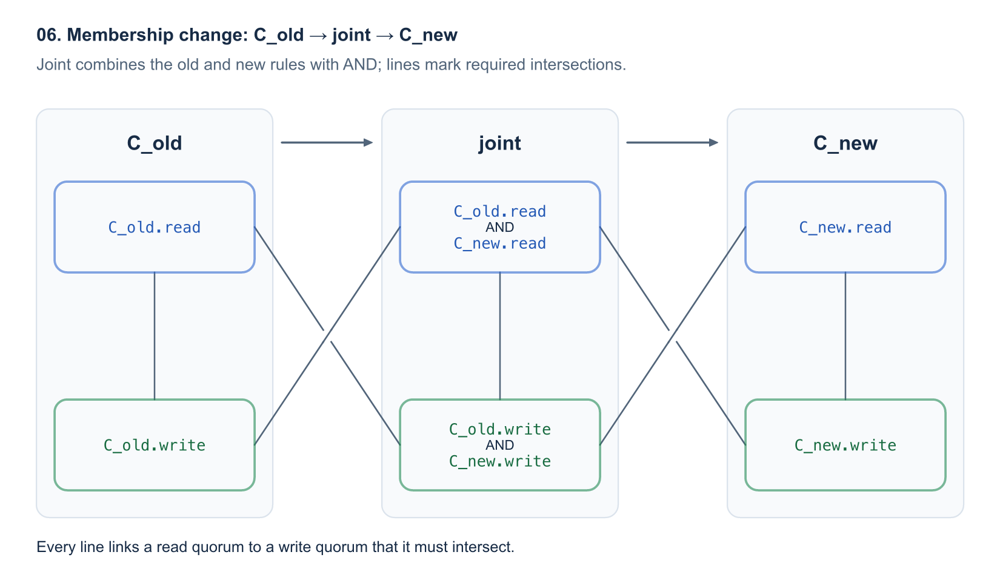

[OpenRaft][repo-openraft] 最近加入了自定义 membership, 让应用决定 election 或 commit 必须等待哪些 node. 4 个 node 的集群可以在取得 2 份复制确认后 commit, 而不必等待通常 majority 所需的 3 份. 9 个 node 分在 3 个机房时, 可以要求任意 2 个机房各有 2 份确认, 用 4 份确认完成 commit, 而不是 5 份.

这项能力对我们很重要, 因为 OpenRaft 为 [Databend Meta Service][repo-databend-meta] 提供共识层. [Databend][repo-databend] 是我们公司的主要项目, 也是一个用 Rust 开发的开源数据仓库. Databend 将表数据存储在对象存储中, 通过 Meta Service 管理数据库和表定义等元数据. OpenRaft 运行在 Meta Service 内部, 负责 election 和 node 间元数据变更的复制.

```text
Databend
+-- Query: 执行查询, 访问对象存储中的表数据
+-- Meta Service: 管理共享元数据
    +-- OpenRaft: election 和元数据变更的复制
```

即使表数据仍然可以访问, 元数据的可用性也会影响数据库操作. 创建表或 commit 元数据更新, 都需要元数据服务继续运行. 因此, 元数据副本的部署位置和 quorum 规则能容忍的故障, 会影响整个数据库.

自定义 membership 让应用直接表达这些要求: 优先保障主机房, 要求副本分布在不同机房, 或者在部分副本不可用时继续 commit. 这些选择各有代价. 减少确认数可以缩短 commit 路径, 但也可能降低持久性, 或让替换 leader 更困难. 即使 quorum 包含的 node 更少, 必须等待的慢机房仍可能主导延迟.

下文的配置用于展示 OpenRaft 的能力, 并不代表 Databend 当前生产环境的 quorum 配置. API 示例和协议细节均以[这里链接的 OpenRaft 版本][provided-memberships]为准.

## 1. election 和 append entries 可以使用不同的 quorum

应用可以减少 commit 等待的副本数, 同时要求 election 收集更多 vote. 例如, node `{1,2,3,4}` 采用 `write quorum = 2`, `read quorum = 3`.

leader 1 收到 `foo=1` 的 client write 后, 在本地保存 log entry, 并向其他 node 发送 append entries. node 2 也保存这条 log entry 后, node `{1,2}` 就构成 write quorum, 允许这条 log entry 按 Raft 的 commit 规则完成 commit. 这 2 份确认包含 leader 自己的副本, 所以 leader 只需等待 1 个 follower.

替换 leader 需要 3 个 node 的 vote. 例如, candidate 3 的日志通过 voter 的新旧检查后, 可以凭 `{1,3,4}` 的 vote 赢得 election. node `{1,3,4}` 构成 read quorum, 与 write quorum `{1,2}` 共享 node 1.

```text
append entries: write quorum {1,2}
election:       read quorum  {1,3,4}
shared voter:               {1}
```

每个 read quorum 都必须与每个 write quorum 相交. 因此, 每次 election 都会遇到至少 1 个保存了相应已 commit log entry 的 node. 这个交集与 Raft 的日志规则和 vote 检查共同保证, 下一任 leader 的日志仍包含已 commit 的 log entry. [Flexible Paxos][flexible-paxos] 描述了类似的 election 与复制 quorum 分离设计.

read quorum 中的 read 指 election 检查 candidate 的日志, 而不是应用读取某个 key 或执行 SQL 查询. linearizable read 仍需通过 OpenRaft 的 leader 身份校验和状态应用进度检查. 设置 `read quorum = 3`, 并不意味着每次应用读取都要获取同一个值的 3 份副本.

election 所需的 vote 数还取决于 leader ID 类型. 下文示例使用 OpenRaft 默认的 advanced leader IDs. 这类 leader ID 具有全序关系, 收集 read quorum 的 vote 即可选出 leader. 使用 standard leader IDs 时, vote 集合必须同时满足 read quorum 和 write quorum 规则. 例如, 3x3 grid 使用 advanced leader IDs 时需要 3 个 vote, 使用 standard leader IDs 时则需要 5 个. [election quorum 文档][election-quorum]解释了这一区别.

其余 node 仍会接收 append entries. 较小的 write quorum 只改变 commit 等待哪些确认, 不会自动减少总复制流量. 它也意味着 commit 时保证已有的副本更少. 这些示例假设故障属于 crash failure, 存储行为正确, 且存活 node 之间可以通信, 不考虑 Byzantine failure.

## 2. 5 种 membership 实现表达不同的部署策略

[`openraft-membership`][provided-memberships] crate 提供 5 种按 node 数, 权重或部署位置定义 quorum 的实现. 每种实现都定义 read 和 write 这 2 类 quorum. 如果 election 和 commit 都适合使用 majority, 仍可使用 OpenRaft 默认的 `Membership`.

### ThresholdMembership: 按 node 数定义 quorum

`ThresholdMembership` 让应用选择 commit 所需的副本数. 对于 4 个 voter, 设置 `write_size = 2` 后, 任意 2 个 voter 就能构成 write quorum. read quorum 自动推导为:

```text
read quorum = voter count - write quorum + 1
            = 4 - 2 + 1
            = 3
```

如果所有 voter 的地位相同, 而且减少 commit 等待比依靠少量存活 node 替换 leader 更重要, 可以选择这种实现. 这个集群的 leader 只需等待 1 个 follower, 而 4 个 node 的 majority 需要等待 2 个 follower.

可用性的取舍会在故障后体现出来. 如果 leader 1 和 node 2 仍在, node 3, 4 故障, leader 就能继续 commit. 但这 2 个存活 node 无法完成 election. 如果集群需要替换 leader, 就必须先恢复另一个 voter.

如果应用要求在确认写入成功前保证更多副本, 就不应使用过小的 write quorum. node 数也不代表故障域: 2 份确认可能来自同一个机架或机房. 如果要求容忍整个机房丢失, 应使用能表达部署位置的规则.

### WeightedMembership: 按 node 权重定义 quorum

`WeightedMembership` 可以让一个机房拥有足够的 vote 和复制权重, 不依赖另一个机房就能运行. 给 node `{1,2,3,4}` 分配权重 `{1:2, 2:1, 3:1, 4:1}`, 总权重为 5. 设置 `write_weight = 3` 后, read weight 也为 3:

```text
read weight = total weight - write weight + 1
            = 5 - 3 + 1
            = 3
```

将 node 1, 2 放在机房 A, node 3, 4 放在机房 B. 机房 A 的权重为 3, 不依赖机房 B 就能完成 election 和 commit. 机房 B 的权重为 2, 离开机房 A 后, 两者都无法完成. node `{2,3,4}` 的权重也为 3, 所以 node 1 故障后, 只要这 3 个 node 仍然可用, 集群就能恢复运行.

如果部署有意优先保障某个机房, 或者不同 voter 应贡献不同权重, 可以选择这种实现. 它只需部署 4 个 node, 就能在次机房故障时保持主机房可用.

这个配置不适合对称的机房故障切换. 机房 A 丢失后, 机房 B 就无法继续运行. 权重也不会增加物理副本, 或自动让权重最高的 node 成为 leader. 如果某个 node 自己的权重就达到 write weight, commit 时可能只有它保存了副本. 分配权重时不仅要计算可用性, 也要审查持久性.

### HierarchicalMembership: 按机房和机架分层定义 quorum

`HierarchicalMembership` 可以表达这样的要求: 任意 2 个机房各有 2 个 node 保存 log entry. 对于 3 个机房, 每个机房 3 个 node 的部署, 将根层的 write size 设为 2 个机房, 每个机房的 write size 设为 2 个 node.



leader 1 可以在机房 A 的 node 1, 2 和机房 B 的 node 4, 5 保存 log entry 后, commit `foo=1`. 这 4 个 node 构成 write quorum, 而不分层的 majority 需要 5 个 node. 推导出的 read 规则同样要求 2 个机房各有 2 个 voter.

如果故障域是需求的一部分, 可以选择这种实现. 机房 A 故障后, 机房 B, C 仍能完成 election 和 commit. 每个机房各丢失 1 个 node 时, 集群也能继续运行. 更多层级还可以表达数据中心, 机架和服务器.

分组边界也带来了限制. 如果只剩 `{1,4,7,8,9}`, 虽然还有 5 个 node 存活, 但只有机房 C 拥有 2 个可用 node. election 和 commit 都无法满足规则. 同样的 9 个 node 如果使用不分层的 majority, 这 5 个存活 node 仍能运行.

不要仅仅因为 4 小于 5 就选择这条规则. 它保证特定的副本分布, 容忍特定的故障, 并不是 majority 的低成本等价替代. 这条规则还要求另一个机房的确认, 因此在机房间无法通信时, 不能只靠本机房完成 commit.

### GridMembership: read quorum 取整行, write quorum 覆盖每行

`GridMembership` 通过布局约束同时减小 read quorum 和 write quorum. 将 9 个 voter 排成 3x3 网格, 任意完整的 1 行构成 read quorum, 每行至少取 1 个 node 构成 write quorum.

```text
election: read quorum {1,2,3}
+-------------------------+
|   [1]      2       3    |
+-------------------------+
     4      [5]      6
     7       8      [9]

[n] = node in write quorum {1,5,9}
```

使用 advanced leader IDs 时, candidate 1 可以凭 `{1,2,3}` 的 vote 赢得 election. node `{1,5,9}` 保存 log entry 后, 这条 log entry 就可以 commit. 每个 write quorum 都覆盖每行, 所以与每个 read quorum 相交. commit 最少需要 3 份确认, election 最少需要 3 个 vote, 而 majority 需要 5 个 node.

如果预期的故障模式适合网格布局, 且较小的 quorum 值得引入这些布局约束, 可以选择这种实现. 当 `{1,2,3,5,9}` 存活时, 第 1 行能够完成 election, `{1,5,9}` 能够完成 commit. 使用 standard leader IDs 时, election 本身需要完整的 1 行, 再加上其他每行各 1 个 voter, 共 5 个 vote.

故障对 election 和 commit 的影响不同. 丢失 node `{1,4,7}` 后, 仍有 6 个 node 存活, 但每行都不完整, 因此无法选出新 leader. 如果原有 leader 仍在存活 node 中, 它仍可使用 `{2,5,8}` 完成 commit. 反过来, 丢失整行会阻止所有 commit, 尽管使用 advanced leader IDs 时, 其他完整行仍能选出 leader. 没有 write quorum 的新 leader 无法完成当前 term 的初始 commit, 也无法提供 linearizable read.

如果主要考虑任意 node 故障, 就不应选择网格. 这个 3x3 网格只能容忍任意 2 个 node 故障, 而 9 个 node 的 majority 可以容忍任意 4 个. 如果将每行映射到一个机房, 每次 commit 还都必须等待所有机房. 只有当网格的故障行为符合部署要求时, 它才有价值, 而不只是因为 quorum 数字较小.

### ExplicitMembership: 直接列出 quorum

`ExplicitMembership` 可以表达其他实现不便描述的策略. 例如, 要求每次 commit 都包含主站 node `{1,2,3}` 中的任意 2 个, 再加上备份 node 9, 而 election 只需主站的 2 个 voter.

```text
minimal read quorum    minimal write quorum
{1,2}                  {1,2,9}
{1,3}                  {1,3,9}
{2,3}                  {2,3,9}
```

这里共有 4 个 voter, 并不要求部署 9 个 node; 9 只是备份 node 的 ID. 一个集合只要包含列出的某个 quorum, 就满足相应规则. 列出的每个 read quorum 都与每个 write quorum 相交, 构造函数会检查这些交集.

如果一个简短的显式列表就能清楚表达重要策略, 可以选择这种实现. 在这个例子中, 每次已确认的写入都在 node 9 上有副本. 代价是同步复制到备份: node 9 或它的网络链路故障时, 所有 commit 都会停止. 使用 advanced leader IDs 时, 2 个主站 voter 仍能完成 election, 但新 leader 仍需 node 9 才能 commit 初始 log entry, 并完成 linearizable read. 使用 standard leader IDs 时, election 也需要 node 9 的 vote.

如果备份故障时仍需保持写入可用, 就不应使用这条策略. 主站故障后, 它也不能让备份机房独立运行. 对于常见的大规模阈值策略, 应避免显式列举: 最小 quorum 的数量会按组合数增长, 验证时还需要逐一比较每个 read quorum 与每个 write quorum. 如果按数量, 权重或树形结构就能表达相同需求, 这些规则会更容易维护.

## 3. 完整的加权 KV 示例: 保持主机房可用

一个跨 2 个机房的元数据 KV 服务, 可以优先保障主机房可用, 而不承诺对称容灾. 假设多数客户端运行在机房 A, 服务应在机房 B 不可用时继续接受写入. 任意 1 个 node 故障, 且其余 3 个 node 仍能通信时, 服务也应继续运行. 运维方接受机房 B 无法独立接管服务的限制.

使用上一节的加权配置:

| Node | 机房 | 权重 | Raft 地址 | 应用地址 |
| --- | --- | --- | --- | --- |
| 1 | A | 2 | `127.0.0.1:37001` | `127.0.0.1:36001` |
| 2 | A | 1 | `127.0.0.1:37002` | `127.0.0.1:36002` |
| 3 | B | 1 | `127.0.0.1:37003` | `127.0.0.1:36003` |
| 4 | B | 1 | `127.0.0.1:37004` | `127.0.0.1:36004` |

read weight 和 write weight 都为 3. 上面的地址用于在 1 台机器上运行示例, 机房 A, B 表示预期部署和故障分组. 这是 OpenRaft [加权 KV 示例][example-weighted]展示的一种应用设计, 不是 Databend Meta Service 的部署方案.

### 选择 membership 和对应的 edit 类型

应用通过 `TypeConfig` 选择 quorum 的表示类型, 以及修改它的操作类型. 示例中的 `types_kv` crate 提供 KV 请求和响应类型.

```rust
use openraft_membership::{WeightedChange, WeightedMembership};

openraft::declare_raft_types!(
    pub TypeConfig:
        D = types_kv::Request,
        R = types_kv::Response,
        Node = openraft::NodeInfo,
        Membership = WeightedMembership<Self::NodeId, Self::Node>,
        MembershipEdit = WeightedChange<Self::NodeId, Self::Node>,
);
```

### 初始化集群, 等待 learner 追上, 再提升为 voter

先初始化 node 1, 等待它成为 leader 并应用初始 log entry. 然后将其他 node 加入为 learner, 再为它们分配 vote 权重. 在下面的异步初始化代码中, `raft` 是按 `TypeConfig` 创建的 node 1 的 Raft 实例, 其余 3 个 node 进程已在运行.

```rust
use std::collections::BTreeMap;
use std::time::Duration;

use openraft::{LogIdOptionExt, NodeInfo};

let node_info = |id: u64| {
    NodeInfo::new(
        format!("127.0.0.1:{}", 37000 + id),
        format!("127.0.0.1:{}", 36000 + id),
    )
};

let membership = WeightedMembership::new(
    BTreeMap::from([(1, 1)]), // 初始 voter 及其权重.
    1,                      // 初始 write weight.
    BTreeMap::from([(1, node_info(1))]),
)?;
raft.initialize(membership).await?;

// 更新 membership 前, leader 的初始 log entry 需要先 commit.
raft.wait(Some(Duration::from_secs(10)))
    .metrics(
        |m| m.current_leader == Some(1) && m.last_applied.index() >= Some(1),
        "node 1 leads and has applied its initial entry",
    )
    .await?;

for id in [2, 3, 4] {
    // true 表示等待 learner 追上后再返回.
    raft.add_learner(id, node_info(id), true).await?;
}

let weights = BTreeMap::from([(1, 2), (2, 1), (3, 1), (4, 1)]);
let change = WeightedChange::weights(weights).with_write_weight(3);
raft.change_membership(change, false).await?;
```

单 node 初始化只是一个准备步骤, 不具备容错能力. 最终 membership 通过 OpenRaft 的 membership change 协议生效. 因为权重发生变化, OpenRaft 会先 commit joint config, 再切换到目标 config. 参数 `false` 表示, 如果有 voter 被降级, 就将其移除, 而不是保留为 learner; 这次变更没有降级任何 voter.

### 完成写入, 停掉次机房, 再次写入

[进程测试][example-test]覆盖了完整的初始化和故障过程, 而不只是检查权重计算:

1. 启动 4 个 node 进程, 初始化 node 1, 加入 learner, 并设置最终权重.
2. 发送 `foo=1` 的 client write, 等待每个 node 都能读到这个值.
3. 停掉 node 3, 4, 模拟机房 B 丢失.
4. 向 leader 1 发送 `foo=2`. node `{1,2}` 保存 log entry, 达到 write weight `2 + 1 = 3`, 因此写入完成 commit.
5. 检查 node 2 读到 `foo=2`, 并检查 node 1 完成 linearizable read, 返回相同的值.

要复现仓库中的测试, 请使用仓库指定的 Rust toolchain, 在本文对应版本运行:

```sh
git clone https://github.com/databendlabs/openraft.git
cd openraft
git checkout 43537dd5b7d247be49c10163cff09700915c0f60
cargo test -p raft-kv-memstore-weighted-membership \
    test_weighted_membership -- --nocapture
```

测试使用应用端口 `36001` 到 `36004`, Raft 端口 `37001` 到 `37004`. 它展示了机房 B 丢失后继续写入和完成 linearizable read 的能力, 并未测试所有可能的 election 或网络分区场景.

### 明确哪些故障会让服务停止

这些权重也能推导出其他故障场景的结果. 替换 leader 的 node 还必须拥有足够新的日志, 并完成正常的 election 和初始 commit 步骤.

| 故障 | 此配置下的结果 |
| --- | --- |
| 机房 B 故障: node 3, 4 停止 | 机房 A 的权重为 3, 可以 commit, 需要时也能选出替换的 leader. |
| 机房间链路故障 | 机房 A 凭权重 3 继续运行. 机房 B 的权重为 2, 无法形成任意一类 quorum. |
| 机房 A 故障: node 1, 2 停止 | 机房 B 的权重为 2, 无法 commit, 也无法选出 leader. |
| node 1 故障, node 2, 3, 4 仍能通信 | 存活 node 的权重为 3, 可以完成 election 和 commit, 但必须跨机房通信. |
| 机房 B 故障后, 机房 A 再丢失任意 1 个 node | 剩余 node 的权重最多为 2, commit 和 election 都会停止. |

同一条规则也决定了持久性的上限: commit 可能只等待机房 A 的 node 1, 2. 条件允许时, 日志仍会继续复制到机房 B, 但写入成功并不保证机房 B 已保存相应 log entry. 如果机房 B 尚未追上, 机房 A 就永久丢失, 最近已确认的写入也可能丢失. 如果要求丢失任意一个机房后仍保留每次已确认的写入, 就需要同步跨机房复制等其他策略, 而不能只靠增加机房 A 的权重.

### 恢复副本, 而不是另建一个集群

机房 B 恢复后, 让 node 3, 4 通过日志复制或 snapshot 追上. 在依赖它们的副本应对后续故障, 或修改其权重之前, 先检查复制进度. 不要在这些副本上再次调用 `initialize()`, 也不要在各 node 上独立设置新权重.

如果机房 A 不可用, 机房 B 拥有权重 2 并不意味着它可以另建一个有权接受写入的集群. 应恢复原集群中足够多的 node, 重新获得 quorum; 或者按照单独制定的灾难恢复流程操作, 并明确其中的数据丢失风险.

可执行示例使用内存存储, 因此终止进程会丢失该进程的本地状态. 生产部署需要持久化日志, vote 和 snapshot. 进程测试展示的是 quorum 行为, 而不是持久化存储的恢复过程.

## 4. membership 保存 quorum 规则, node 信息和 role

quorum 策略是需要复制的集群配置, 不是每台服务器各自的本地设置. membership 包含 read quorum 和 write quorum 规则, 已知 node 的 ID 和地址, 以及使用这些 node 所需的 role. OpenRaft 将 membership 记录为 config log entry, 让副本同时收到 quorum 策略和 node 信息.



node 信息告诉 OpenRaft 如何连接副本. 这些元数据由应用定义, 可以包含网络地址和机房信息. `NodeId` 独立于地址标识 node, 常见的选择是 `u64`.

role 区分接收日志和发起 election 的能力. learner 通常具有 `NodeRole::ReceiveLogs`, 但不属于任意一类 quorum. 只有 `ReceiveLogs` 的 voter 可以保存日志和 vote, 但不会自行发起 election. `Campaigner` 允许 node 自行发起 election. 每个 write voter 都必须接收日志, 因为 commit 不能依赖一个从不保存 log entry 的 node 的确认.

### membership change: joint 期间同时满足旧, 新规则

即使 node 集合不变, 修改 quorum 规则也需要协调. 例如, 将 node 1 的额外权重转移给 node 3. 旧配置下, 机房 A 可以通过 `{1,2}` 完成 commit; 新配置下, 机房 B 可以通过 `{3,4}` 完成 election. 这 2 个集合没有交集, 因此各 node 独立切换配置, 会让新 election 错过旧配置下已 commit 的 log entry.

如果旧, 新规则无法证明可以安全地直接切换, OpenRaft 就会使用 joint config:

```text
C_old -> joint -> C_new

joint.read  = C_old.read  AND C_new.read
joint.write = C_old.write AND C_new.write
```

joint 的 read quorum 同时满足旧, 新的 read 规则, write quorum 同时满足旧, 新的 write 规则. joint config 完成 commit 后, OpenRaft 就可以切换到目标 config.



只有当每个旧 read quorum 都与每个新 write quorum 相交, 且每个新 read quorum 都与每个旧 write quorum 相交时, 才允许直接切换. 现成的 membership 实现会检查能否证明这 2 类交集. 无法证明时, OpenRaft 就使用 joint. 现成的加权实现修改权重时会使用 joint, 即使 voter 集合本身没有变化.

应在旧, 新 voter 都有足够数量可用, 能满足 joint 规则时规划变更. 即使目标 config 能在某次故障后运行, 如果集群无法从当前 config 安全地切换过去, 这个目标 config 也无济于事.

## 5. 仅在现成规则不足时实现自己的 membership

自定义 membership 可以表达应用特有的策略, 而复制和 election 仍由 OpenRaft 负责. 实现新类型前, 先检查现成实现是否已经能表达需求. 例如, 主站加备份的策略只需使用 `ExplicitMembership`.

自定义的 `MyMembership` 实现 [`RaftMembership`][trait-membership], 主要职责如下:

| 方法 | 职责 |
| --- | --- |
| `read_quorum_set()`, `write_quorum_set()` | 返回 election 的 read 规则和复制的 write 规则. |
| `get_node(node_id)`, `node_ids()` | 查询每个 quorum 参与者的 node 信息, 并列出所有已知 node, 包括 learner. |
| `read_write_quorums_intersect()` | 证明每个 read quorum 都与每个 write quorum 相交. 只有返回 `Some(true)` 时, OpenRaft 才接受应用提供的 membership. |
| `supports_direct_transition_to(other)` | 只有 2 类跨 config 交集都成立时才允许直接切换, 否则要求使用 joint. |
| `joint_with(goal)` | 构造 read quorum 和 write quorum 都同时满足旧, 目标规则的 config. |

实现还需定义 `NodeId`, `Node`, `QuorumSet` 和 node 迭代器 `Iter`. quorum set 实现 [`QuorumSet::is_quorum()`][trait-quorum-set], 并通过 `ids()` 列出参与者. [`QuorumIntersection::intersects_with()`][trait-quorum-intersection]表示一条规则的每个 quorum 是否都与另一条规则的每个 quorum 相交.

对于主站加备份的策略, write 规则应接受 `{1,2,9}`, 拒绝 `{1,2}`, read 规则应接受 `{1,2}`. 测试不仅要检查应该接受的集合, 也要检查应该拒绝的集合, 然后覆盖 node 故障和切换到新策略的场景.

对应的 `MyEdit` 实现 [`RaftMembershipEdit<MyMembership>`][trait-edit]. `apply(membership, retain)` 生成目标 config, `add_learner(node_id, node)` 构造添加 learner 的操作, `make_uniform()` 构造结束 joint 的操作. 通过 `TypeConfig::Membership` 和 `TypeConfig::MembershipEdit` 选择这 2 个自定义类型.

edit 类型独立于 membership 的表示类型. 应用可以保留现成的 membership, 仅实现自己的 edit 操作, [自定义操作测试][test-custom-edit]展示了这种用法.

OpenRaft 信任自定义实现对交集和切换安全性的判断. 没有有效证明就返回 `Some(true)`, 或允许直接切换, 可能导致已 commit 的 log entry 丢失. 现成实现满足需求时应优先使用, 并将自定义 quorum 逻辑视为共识协议的一部分, 而不是普通配置代码.

## 6. 先选择故障策略, 再选择 quorum 大小

自定义 membership 让部署决定 commit 必须保证什么, 以及哪些故障发生后仍应保持可用. 阈值规则选择副本数, 权重规则优先保障特定 node 或机房, 分层规则表达故障域, 网格用较低的任意故障容忍度换取更小的 quorum, 显式列表则直接表达特殊要求.

对于 Databend 以及其他使用多副本元数据服务的系统, 这些选择会影响维持数据库协调运行的操作. 合适的起点是一个具体要求: 次机房故障时继续运行, 丢失一个机房后保留每次已确认的写入, 或在特定的一组 node 故障后选出新 leader. 然后, 选择能满足要求的最简单的 quorum 规则.

**现有 leader 能否继续 commit, 与集群能否选出替换的 leader, 是 2 项独立的可用性保证.** 评估时应同时检查这 2 项保证, commit 时保证已有的副本, 以及 membership change 的切换路径. 只有当较小 quorum 带来的故障策略符合应用需求时, 它才有价值.

[repo-openraft]: https://github.com/databendlabs/openraft
[repo-databend]: https://github.com/databendlabs/databend
[repo-databend-meta]: https://github.com/databendlabs/databend-meta/blob/a42ea5bde4e4cab3619ca68479b61a9a4373aefd/README.md
[provided-memberships]: https://github.com/databendlabs/openraft/blob/43537dd5b7d247be49c10163cff09700915c0f60/membership/src/docs.md
[example-weighted]: https://github.com/databendlabs/openraft/tree/43537dd5b7d247be49c10163cff09700915c0f60/examples/raft-kv-memstore-weighted-membership
[example-test]: https://github.com/databendlabs/openraft/blob/43537dd5b7d247be49c10163cff09700915c0f60/examples/raft-kv-memstore-weighted-membership/tests/cluster/test_weighted_membership.rs
[trait-membership]: https://github.com/databendlabs/openraft/blob/43537dd5b7d247be49c10163cff09700915c0f60/openraft/src/membership/raft_membership.rs
[trait-edit]: https://github.com/databendlabs/openraft/blob/43537dd5b7d247be49c10163cff09700915c0f60/openraft/src/membership/raft_membership_edit.rs
[test-custom-edit]: https://github.com/databendlabs/openraft/blob/43537dd5b7d247be49c10163cff09700915c0f60/tests/tests/membership/t41_custom_membership_edit.rs
[election-quorum]: https://github.com/databendlabs/openraft/blob/43537dd5b7d247be49c10163cff09700915c0f60/openraft/src/docs/protocol/election_quorum.md
[trait-quorum-set]: https://docs.rs/quorum-set/0.6.0/quorum_set/trait.QuorumSet.html#tymethod.is_quorum
[trait-quorum-intersection]: https://docs.rs/quorum-set/0.6.0/quorum_set/trait.QuorumIntersection.html#tymethod.intersects_with
[flexible-paxos]: https://arxiv.org/abs/1608.06696
