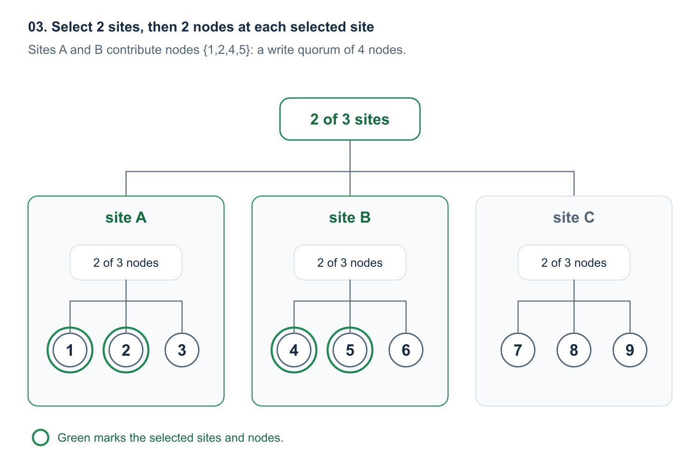
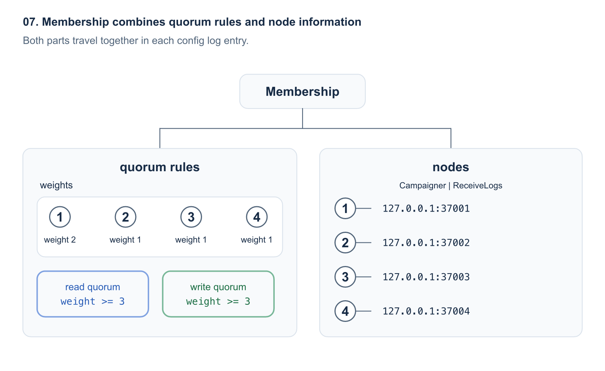
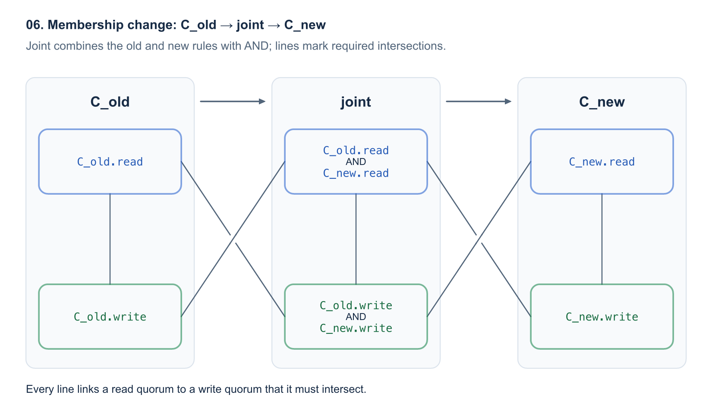

[OpenRaft][repo-openraft] now supports custom membership, so applications can choose which nodes an election or a commit must wait for. A cluster of 4 nodes can commit with 2 replication confirmations instead of the usual majority of 3. A cluster of 9 nodes across 3 sites can require 2 confirmations at each of any 2 sites, committing with 4 confirmations instead of 5.

This capability matters to us because OpenRaft provides the consensus layer for [Databend's Meta Service][repo-databend-meta]. [Databend][repo-databend], our company's main project, is an open-source data warehouse built in Rust. Databend stores table data in object storage and uses Meta Service to manage metadata, including database and table definitions. OpenRaft runs inside Meta Service to elect leaders and replicate metadata changes among its nodes.

```text
Databend
+-- Query: executes queries and accesses table data in object storage
+-- Meta Service: manages shared metadata
    +-- OpenRaft: leader election and replicated metadata changes
```

Metadata availability affects database operations even when the table data is still accessible. Creating a table or committing a metadata update needs the metadata service to make progress. The placement of its replicas, and the failures its quorum rules tolerate, therefore matter to the database as a whole.

Custom membership lets an application express those requirements directly: prefer a primary site, require copies in separate sites, or keep committing while some replicas are unavailable. These choices have different costs. Fewer confirmations can shorten the commit path, but they can also reduce durability or make leader replacement harder. A slow required site can dominate latency even when the quorum contains fewer nodes.

The configurations below demonstrate OpenRaft's capabilities. They do not describe Databend's current production quorum configuration. The API examples and protocol details refer to the [OpenRaft revision linked here][provided-memberships].

## 1. Elections and append entries can use different quorums

An application can reduce the replicas a commit waits for while requiring more votes in an election. Consider nodes `{1,2,3,4}`, with `write quorum = 2` and `read quorum = 3`.

Leader 1 receives a client write `foo=1`. It stores the log entry locally and sends append entries to the other nodes. Once node 2 also stores the entry, nodes `{1,2}` form a write quorum, allowing the entry to commit under Raft's commit rules. The 2 confirmations include the leader's own copy; the leader waits for only 1 follower.

A replacement leader needs votes from 3 nodes. For example, candidate 3 can win with votes from `{1,3,4}`, provided its log passes the voters' up-to-date checks. Nodes `{1,3,4}` form a read quorum. This read quorum shares node 1 with the write quorum `{1,2}`.

```text
append entries: write quorum {1,2}
election:       read quorum  {1,3,4}
shared voter:               {1}
```

Every read quorum must intersect every write quorum. An election therefore reaches at least 1 node holding each committed entry. Together with Raft's log rules and vote checks, that intersection keeps committed entries in the next leader's log. [Flexible Paxos][flexible-paxos] describes a similar separation between election and replication quorums.

The name read quorum refers to an election checking the candidate's log, not to an application reading a key or executing a SQL query. A linearizable read still uses OpenRaft's leadership validation and applied-state checks. Choosing `read quorum = 3` does not mean every application read fetches 3 copies of its value.

Election counts also depend on the leader ID type. The examples below use OpenRaft's default, advanced leader IDs, which totally order leader IDs and let a read quorum elect a leader. With standard leader IDs, the vote set must satisfy both the read and write quorum rules. For example, a 3x3 grid needs 3 election votes with advanced leader IDs, but 5 with standard leader IDs. The [election quorum documentation][election-quorum] explains the distinction.

The remaining nodes still receive append entries. A smaller write quorum changes which confirmations a commit waits for; it does not automatically reduce total replication traffic. It also guarantees fewer copies at the moment of commit. The examples assume crash failures, correct storage behavior, and communication among the surviving nodes, not Byzantine failures.

## 2. 5 membership implementations express different deployment policies

The [`openraft-membership`][provided-memberships] crate provides 5 implementations based on node count, weight, or placement. Each implementation defines both quorum families. OpenRaft's default `Membership` remains available when a majority is the right rule for elections and commits.

### ThresholdMembership: quorums by node count

`ThresholdMembership` lets an application choose how many copies a commit needs. For 4 voters and `write_size = 2`, any 2 voters form a write quorum. The read quorum is derived automatically:

```text
read quorum = voter count - write quorum + 1
            = 4 - 2 + 1
            = 3
```

Choose this implementation when all voters count equally and reducing the commit wait matters more than replacing the leader with a small surviving group. A leader in this cluster waits for 1 follower instead of the 2 followers required by a majority of 4.

The availability trade-off appears after failures. If leader 1 and node 2 remain while nodes 3 and 4 fail, the leader can keep committing. But those 2 surviving nodes cannot complete an election. If the cluster needs a replacement leader, it must recover another voter first.

Do not use a small write quorum when the application requires more guaranteed copies before acknowledging a write. Node count also says nothing about failure domains: 2 confirmations may come from the same rack or site. Use a placement-aware rule when the requirement is to survive the loss of a whole site.

### WeightedMembership: quorums by node weight

`WeightedMembership` lets one site retain enough voting and replication weight to operate without another site. Give nodes `{1,2,3,4}` weights `{1:2, 2:1, 3:1, 4:1}`. The total weight is 5. With `write_weight = 3`, the read weight is also 3:

```text
read weight = total weight - write weight + 1
            = 5 - 3 + 1
            = 3
```

Put nodes 1 and 2 at site A, and nodes 3 and 4 at site B. Site A has weight 3, so it can elect a leader and commit without site B. Site B has weight 2, so it cannot do either without site A. Nodes `{2,3,4}` also have weight 3, allowing the cluster to recover from node 1's failure while those 3 nodes remain available.

Choose this implementation when the deployment deliberately favors one site, or when voters should contribute unequally. It can keep a primary site available through a secondary-site outage while keeping the deployment at 4 nodes.

Do not use this configuration for symmetric site failover. Losing site A stops progress at site B. Weights also do not create physical replicas or automatically make the highest-weight node the leader. If a node's weight alone reaches the write weight, a commit may have only that node's copy. Weight assignments need a durability review, not just an availability calculation.

### HierarchicalMembership: quorums by site and rack

`HierarchicalMembership` expresses a requirement such as storing a log entry on 2 nodes at each of any 2 sites. With 3 sites of 3 nodes each, set the root's write size to 2 sites and each site's write size to 2 nodes.



Leader 1 can commit `foo=1` after nodes 1 and 2 at site A and nodes 4 and 5 at site B store the entry. Those 4 nodes form a write quorum, compared with 5 nodes for a flat majority. The derived read rule also requires 2 voters at each of 2 sites.

Choose this implementation when failure domains are part of the requirement. If site A fails, sites B and C can still elect a leader and commit. The cluster also survives the loss of 1 node in each site. More levels can express datacenters, racks, and servers.

The group boundaries also create limits. If only `{1,4,7,8,9}` remain, 5 nodes are alive, but only site C has 2 available nodes. Neither an election nor a commit can satisfy the rule. A flat majority of the same 9 nodes could still operate with those 5 survivors.

Do not choose this rule solely because 4 is smaller than 5. It guarantees a particular spread of copies and tolerates particular failures; it is not a cheaper equivalent of a majority. It also requires confirmation from another site, so it cannot provide site-local commits when inter-site communication is unavailable.

### GridMembership: read quorums use a full row, write quorums cover every row

`GridMembership` can reduce both quorum sizes by imposing a layout. Arrange 9 voters in a 3x3 grid. A full row forms a read quorum, and at least 1 node from every row forms a write quorum.

```text
election: read quorum {1,2,3}
+-------------------------+
|   [1]      2       3    |
+-------------------------+
     4      [5]      6
     7       8      [9]

[n] = node in write quorum {1,5,9}
```

Candidate 1 can win with votes from `{1,2,3}` under advanced leader IDs. A log entry can commit after nodes `{1,5,9}` store it. Every write quorum touches every row, so it intersects every read quorum. The minimum is 3 confirmations for a commit and 3 votes for an election, rather than a majority of 5.

Choose this implementation when the expected failure patterns fit the grid and smaller quorums justify the placement constraints. With live nodes `{1,2,3,5,9}`, the first row can elect a leader, and `{1,5,9}` can commit. Under standard leader IDs, the election itself needs a full row plus a voter from each other row: 5 votes.

Failures affect elections and commits differently. Losing nodes `{1,4,7}` leaves 6 live nodes but breaks every full row, so no new leader can be elected. An existing leader among the survivors can still commit using `{2,5,8}`. Losing a whole row instead stops every commit, even though another full row can still elect a leader under advanced leader IDs. A newly elected leader without a write quorum cannot complete its term's initial commit or serve linearizable reads.

Do not use a grid when arbitrary node failures are the main concern. This 3x3 grid tolerates any 2 node failures, while a majority of 9 tolerates any 4. Mapping each row to a site also makes every site mandatory for commits. A grid is useful only when its failure behavior matches the deployment, not merely because its quorum counts are small.

### ExplicitMembership: list the quorums directly

`ExplicitMembership` states policies that the other implementations cannot express conveniently. For example, require 2 of primary nodes `{1,2,3}` plus backup node 9 for every commit, while allowing an election to use 2 primary voters.

```text
minimal read quorum    minimal write quorum
{1,2}                  {1,2,9}
{1,3}                  {1,3,9}
{2,3}                  {2,3,9}
```

These are 4 voting nodes, not a requirement for 9 nodes; 9 is simply the backup's ID. A set qualifies if it contains a listed quorum. Every listed read quorum intersects every listed write quorum, and the constructor checks those intersections.

Choose this implementation when a small, explicit list states an important policy clearly. In this example, every acknowledged write has a copy at node 9. The cost is synchronous backup replication: if node 9 or its network link fails, every commit stops. Two primary voters can still complete an election under advanced leader IDs, but a new leader still needs node 9 to commit its initial entry and complete linearizable reads. Standard leader IDs require node 9's vote for the election as well.

Do not use this policy if backup outages must leave writes available. It also does not make the backup site independently available after the primary site fails. Avoid explicit lists for ordinary large threshold policies: the number of minimal quorums grows combinatorially, and validation compares every listed read quorum with every listed write quorum. A count, weight, or tree rule is easier to maintain when it expresses the same requirement.

## 3. A complete weighted KV example: keep a primary site available

A 2-site metadata KV service can favor primary-site availability without claiming symmetric disaster recovery. Suppose most clients run at site A. The service should keep accepting writes when site B is unavailable, and it should tolerate any 1 node failure while the other 3 nodes can communicate. The operator accepts that site B cannot take over by itself.

Use the weighted configuration from the previous section:

| Node | Site | Weight | Raft address | Application address |
| --- | --- | --- | --- | --- |
| 1 | A | 2 | `127.0.0.1:37001` | `127.0.0.1:36001` |
| 2 | A | 1 | `127.0.0.1:37002` | `127.0.0.1:36002` |
| 3 | B | 1 | `127.0.0.1:37003` | `127.0.0.1:36003` |
| 4 | B | 1 | `127.0.0.1:37004` | `127.0.0.1:36004` |

Both the read weight and write weight are 3. The addresses above run the example on 1 machine; sites A and B describe the intended deployment and failure grouping. This is an application design illustrated by OpenRaft's [weighted KV example][example-weighted], not a Databend Meta Service deployment recipe.

### Select the membership and its edit type

The application's `TypeConfig` selects both the quorum representation and the operations used to change it. The example's `types_kv` crate supplies the KV request and response types.

```rust
use openraft_membership::{WeightedChange, WeightedMembership};

openraft::declare_raft_types!(
    pub TypeConfig:
        D = types_kv::Request,
        R = types_kv::Response,
        Node = openraft::NodeInfo,
        Membership = WeightedMembership<Self::NodeId, Self::Node>,
        MembershipEdit = WeightedChange<Self::NodeId, Self::Node>,
);
```

### Bootstrap, catch up learners, and promote the voters

Initialize node 1 and wait for it to lead and apply its initial entry. Then add the other nodes as learners before assigning voting weights. In the following async setup code, `raft` is node 1's Raft instance constructed with `TypeConfig`, and the other 3 node processes are already running.

```rust
use std::collections::BTreeMap;
use std::time::Duration;

use openraft::{LogIdOptionExt, NodeInfo};

let node_info = |id: u64| {
    NodeInfo::new(
        format!("127.0.0.1:{}", 37000 + id),
        format!("127.0.0.1:{}", 36000 + id),
    )
};

let membership = WeightedMembership::new(
    BTreeMap::from([(1, 1)]), // Initial voter and its weight.
    1,                      // Initial write weight.
    BTreeMap::from([(1, node_info(1))]),
)?;
raft.initialize(membership).await?;

// Membership updates need the leader's initial entry to be committed.
raft.wait(Some(Duration::from_secs(10)))
    .metrics(
        |m| m.current_leader == Some(1) && m.last_applied.index() >= Some(1),
        "node 1 leads and has applied its initial entry",
    )
    .await?;

for id in [2, 3, 4] {
    // true waits for the learner to catch up before returning.
    raft.add_learner(id, node_info(id), true).await?;
}

let weights = BTreeMap::from([(1, 2), (2, 1), (3, 1), (4, 1)]);
let change = WeightedChange::weights(weights).with_write_weight(3);
raft.change_membership(change, false).await?;
```

The single-node bootstrap is only a setup step; it is not fault-tolerant. The final membership becomes effective through OpenRaft's membership-change protocol. Because the weights change, OpenRaft commits a joint config before moving to the target config. The `false` argument means demoted voters would be removed rather than retained as learners; this change demotes none.

### Commit a write, stop the secondary site, and write again

The [process test][example-test] exercises the entire setup and outage sequence, rather than checking weight arithmetic alone:

1. Start 4 node processes, initialize node 1, add learners, and set the final weights.
2. Send the client write `foo=1` and wait until every node can read that value.
3. Stop nodes 3 and 4, representing the loss of site B.
4. Send `foo=2` to leader 1. Nodes `{1,2}` store the entry and reach write weight `2 + 1 = 3`, so the write commits.
5. Check that node 2 reads `foo=2`, and that node 1 completes a linearizable read returning the same value.

To reproduce the checked-in test, use the repository's Rust toolchain and run it at the revision used in this article:

```sh
git clone https://github.com/databendlabs/openraft.git
cd openraft
git checkout 43537dd5b7d247be49c10163cff09700915c0f60
cargo test -p raft-kv-memstore-weighted-membership \
    test_weighted_membership -- --nocapture
```

The test uses application ports `36001` through `36004` and Raft ports `37001` through `37004`. It demonstrates continued writes and a linearizable read after losing site B. It does not test every possible election or partition scenario.

### Understand which failures stop this service

The weights predict the other failure cases. Any replacement leader must also have a sufficiently up-to-date log and complete the normal election and initial-commit steps.

| Failure | Result under this configuration |
| --- | --- |
| Site B fails: nodes 3 and 4 stop | Site A has weight 3. It can commit and elect a replacement leader if needed. |
| The link between sites fails | Site A can operate with its weight 3. Site B cannot form either quorum with weight 2. |
| Site A fails: nodes 1 and 2 stop | Site B has weight 2. It cannot commit or elect a leader. |
| Node 1 fails while nodes 2, 3, and 4 remain connected | The survivors have weight 3. They can elect a leader and commit, but must communicate across sites. |
| Site B fails, followed by either node at site A | The remaining node has weight at most 2. Both commits and elections stop. |

The durability limit follows from the same rule: a commit may wait only for nodes 1 and 2 at site A. Replication to site B continues when possible, but a successful write does not guarantee that site B already holds the entry. Permanent loss of site A before replication catches up can therefore lose the latest acknowledged writes. A requirement to preserve every acknowledged write after losing either site needs a different policy, such as synchronous cross-site replication; it cannot be obtained by assigning more weight to site A.

### Recover replicas without creating a second cluster

After site B returns, let nodes 3 and 4 catch up through log replication or a snapshot. Check their replication progress before counting on their copies for a later failure or changing their weights. Do not call `initialize()` again on those replicas or assign new weights independently on each node.

If site A is unavailable, site B's weight 2 is not permission to form a new authoritative cluster. Restore enough of the existing cluster to regain a quorum, or follow a separate, explicitly planned disaster-recovery procedure with its data-loss implications.

The executable example uses in-memory storage, so killing a process loses that process's local state. Production deployments need durable logs, votes, and snapshots. The process test demonstrates quorum behavior, not persistent-storage recovery.

## 4. Membership stores quorum rules, node information, and roles

A quorum policy is replicated cluster configuration, not a local setting on each server. Membership contains the read and write quorum rules, the known node IDs and addresses, and the roles needed to use those nodes. OpenRaft records membership in config log entries so replicas receive the policy together with the node information.



Node information tells OpenRaft how to reach a replica. The application defines that metadata, which can include network addresses and site information. `NodeId` identifies the node independently of its address; a common choice is `u64`.

Roles separate receiving logs from starting elections. A learner normally has `NodeRole::ReceiveLogs` but belongs to neither quorum family. A voter with only `ReceiveLogs` can store logs and vote without starting its own elections. `Campaigner` lets a node start an election on its own. Every write voter must receive logs, because a commit cannot use an acknowledgment from a node that never stores the entry.

### Membership change: satisfy the old and new rules during joint

Changing quorum rules needs coordination even when the node set stays the same. For example, move the extra weight from node 1 to node 3. The old site A can commit on `{1,2}`, while the new site B can elect on `{3,4}`. Those sets are disjoint, so switching nodes independently would let a new election miss an old commit.

OpenRaft uses a joint config when the old and new rules do not prove a safe direct transition:

```text
C_old -> joint -> C_new

joint.read  = C_old.read  AND C_new.read
joint.write = C_old.write AND C_new.write
```

A joint read quorum satisfies both read rules. A joint write quorum satisfies both write rules. Once the joint config commits, OpenRaft can move to the target config.



A direct transition is allowed only when every old read quorum intersects every new write quorum, and every new read quorum intersects every old write quorum. The provided implementations check whether they can establish those cross-intersections. If they cannot, OpenRaft uses joint. Changes to weights in the provided weighted implementation use joint even when the voters themselves stay the same.

Plan changes while enough old and new voters are available to satisfy the joint rules. A target config that would work after an outage is not useful if the cluster cannot safely reach it from the current config.

## 5. Implement your own membership only when the provided rules are insufficient

A custom membership can express an application-specific policy while OpenRaft retains responsibility for replication and elections. Before implementing a new type, check whether a provided implementation already states the policy. The primary-plus-backup example, for instance, needs only `ExplicitMembership`.

A custom `MyMembership` implements [`RaftMembership`][trait-membership]. Its main responsibilities are:

| Method | Responsibility |
| --- | --- |
| `read_quorum_set()`, `write_quorum_set()` | Return the election read rule and the replication write rule. |
| `get_node(node_id)`, `node_ids()` | Resolve every quorum participant and list every known node, including learners. |
| `read_write_quorums_intersect()` | Prove that every read quorum intersects every write quorum. OpenRaft accepts an application-supplied membership only for `Some(true)`. |
| `supports_direct_transition_to(other)` | Allow a direct transition only when both cross-intersections hold. Otherwise require joint. |
| `joint_with(goal)` | Build a config whose read and write quorums satisfy both the old and target rules. |

The implementation also defines `NodeId`, `Node`, `QuorumSet`, and the node iterator `Iter`. The quorum set implements [`QuorumSet::is_quorum()`][trait-quorum-set] and lists its participants through `ids()`. [`QuorumIntersection::intersects_with()`][trait-quorum-intersection] reports whether every quorum of one rule intersects every quorum of the other.

For the primary-plus-backup policy, the write rule should accept `{1,2,9}` and reject `{1,2}`. The read rule should accept `{1,2}`. Tests should check rejected sets as well as accepted ones, then cover node failures and transitions to new policies.

A corresponding `MyEdit` implements [`RaftMembershipEdit<MyMembership>`][trait-edit]. `apply(membership, retain)` produces a target config, `add_learner(node_id, node)` constructs a learner-addition operation, and `make_uniform()` constructs the operation that ends joint. Select both custom types through `TypeConfig::Membership` and `TypeConfig::MembershipEdit`.

The edit type is independent of the membership representation. An application can keep a provided membership and implement only its own edit operations, as the [custom edit test][test-custom-edit] demonstrates.

OpenRaft trusts the custom implementation's intersection and transition answers. Returning `Some(true)` or allowing a direct transition without a valid proof can lose committed entries. Use a provided implementation when it fits, and treat custom quorum logic as part of the consensus protocol rather than ordinary configuration code.

## 6. Choose the failure policy before the quorum size

Custom membership lets a deployment choose what a commit must preserve and which failures should leave it available. Thresholds choose copy counts. Weights favor selected nodes or sites. Hierarchies encode failure domains. Grids trade arbitrary-failure tolerance for smaller quorums. Explicit lists state unusual requirements directly.

For Databend and other systems with a replicated metadata service, these choices affect the operations that keep the database coordinated. The useful starting point is a concrete requirement: continue through a secondary-site outage, preserve every acknowledged write after a site loss, or recover a leader after a particular set of node failures. Then select the simplest quorum rule that meets that requirement.

**An existing leader's ability to keep committing and the cluster's ability to elect its replacement are separate availability guarantees.** Evaluate both, along with the copies guaranteed at commit and the path through membership changes. A smaller quorum is valuable only when the resulting failure policy is the one the application needs.

[repo-openraft]: https://github.com/databendlabs/openraft
[repo-databend]: https://github.com/databendlabs/databend
[repo-databend-meta]: https://github.com/databendlabs/databend-meta/blob/a42ea5bde4e4cab3619ca68479b61a9a4373aefd/README.md
[provided-memberships]: https://github.com/databendlabs/openraft/blob/43537dd5b7d247be49c10163cff09700915c0f60/membership/src/docs.md
[example-weighted]: https://github.com/databendlabs/openraft/tree/43537dd5b7d247be49c10163cff09700915c0f60/examples/raft-kv-memstore-weighted-membership
[example-test]: https://github.com/databendlabs/openraft/blob/43537dd5b7d247be49c10163cff09700915c0f60/examples/raft-kv-memstore-weighted-membership/tests/cluster/test_weighted_membership.rs
[trait-membership]: https://github.com/databendlabs/openraft/blob/43537dd5b7d247be49c10163cff09700915c0f60/openraft/src/membership/raft_membership.rs
[trait-edit]: https://github.com/databendlabs/openraft/blob/43537dd5b7d247be49c10163cff09700915c0f60/openraft/src/membership/raft_membership_edit.rs
[test-custom-edit]: https://github.com/databendlabs/openraft/blob/43537dd5b7d247be49c10163cff09700915c0f60/tests/tests/membership/t41_custom_membership_edit.rs
[election-quorum]: https://github.com/databendlabs/openraft/blob/43537dd5b7d247be49c10163cff09700915c0f60/openraft/src/docs/protocol/election_quorum.md
[trait-quorum-set]: https://docs.rs/quorum-set/0.6.0/quorum_set/trait.QuorumSet.html#tymethod.is_quorum
[trait-quorum-intersection]: https://docs.rs/quorum-set/0.6.0/quorum_set/trait.QuorumIntersection.html#tymethod.intersects_with
[flexible-paxos]: https://arxiv.org/abs/1608.06696
