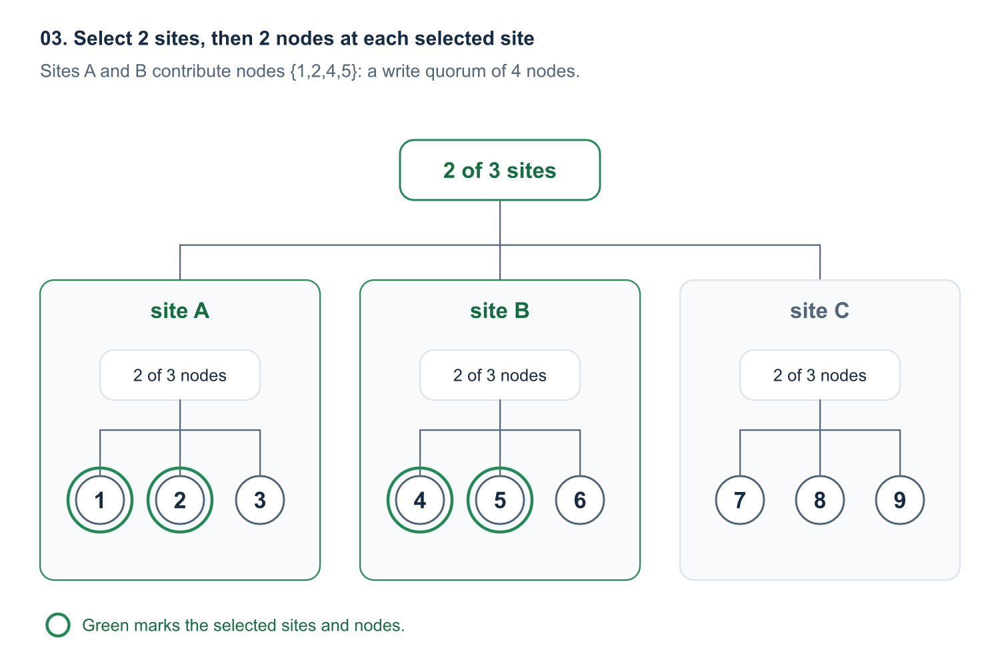
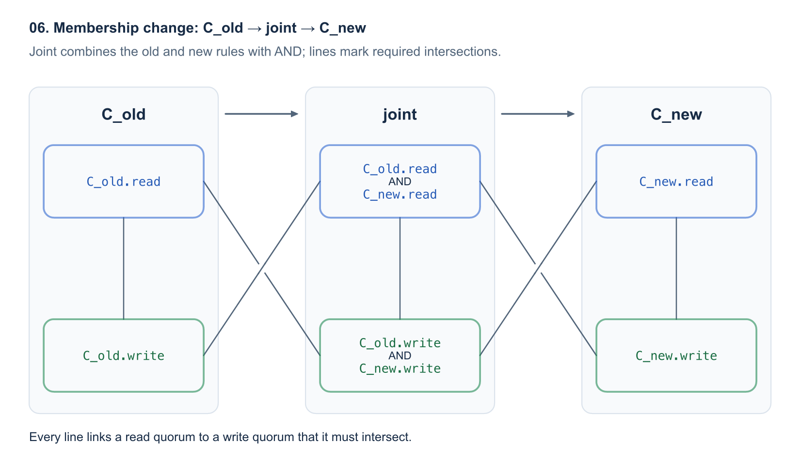
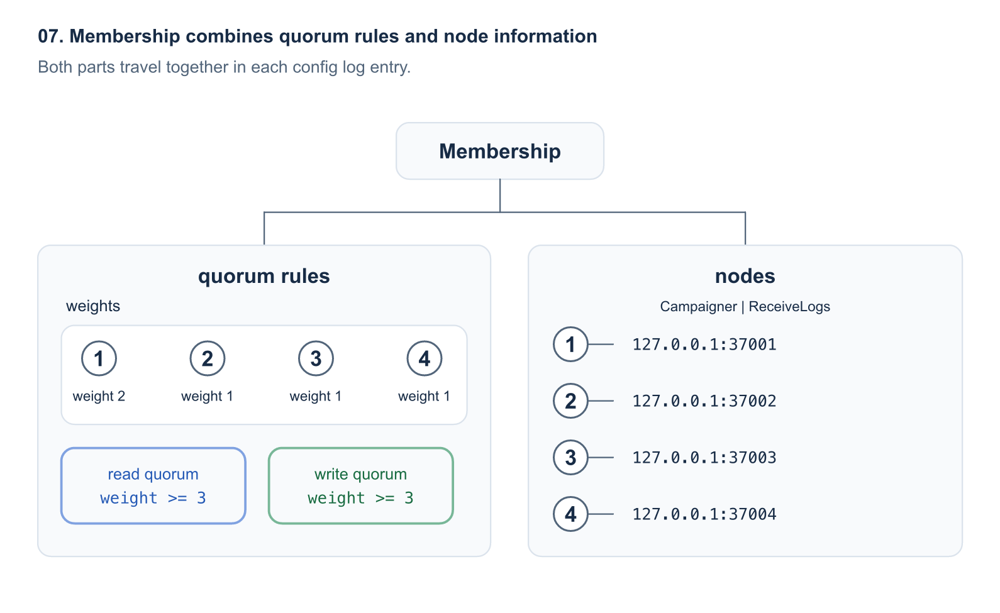

[OpenRaft][repo-openraft] now supports custom membership. Applications can choose the quorums for elections and append entries instead of always using a majority.

For example:

- A cluster of 4 nodes can use `read quorum = 3` and `write quorum = 2`. An election needs 3 votes. For append entries, a log entry can commit once 2 nodes confirm replication. That is 1 fewer node than a majority.
- With 9 nodes across 3 sites, a write quorum can require 2 nodes at each of any 2 sites. The entry can commit after 4 replication confirmations, again 1 fewer than a majority.
- And so on.

The read quorum, write quorum, and node addresses together form the cluster's membership. Applications can use a membership implementation provided by OpenRaft or define their own.

## 1. Elections and append entries can use different quorums

With nodes `{1,2,3,4}`, `read quorum = 3`, and `write quorum = 2`, 2 replication confirmations are enough to commit a log entry.

For example, leader 1 receives a client write `foo=1`. Leader 1 saves the log entry locally and replicates it to node 2 through append entries. Nodes `{1,2}` form the entry's **write quorum**, allowing it to commit.

In an election, a candidate uses request vote to collect 3 votes. For example, node 1 wins with its own vote and votes from nodes 3 and 4. Nodes `{1,3,4}` form the election's **read quorum**. Here, read refers to voters checking how current the candidate's log is when handling a vote request.

```text
election: read quorum
+---------------------------------+
| node 3    node 4                |
|                   +-------------+-------------+
|                   |   node 1    |   node 2    |
+-------------------+-------------+             |
                    +---------------------------+
                    append entries: write quorum
```

The other nodes still receive append entries.

Membership stores the read quorum, write quorum, and node addresses.

See the [OpenRaft documentation][election-quorum] for the full election rules. [Flexible Paxos][flexible-paxos] describes a similar separation of quorums in Paxos.

## 2. 5 common membership implementations are ready to use

The [`openraft-membership`][provided-memberships] crate provides 5 implementations for defining quorums by replica count, node weight, or site.

### ThresholdMembership: quorums by node count

For example, a `ThresholdMembership` can define a cluster with nodes `{1,2,3,4}` and `write_size = 2`. Any 2 nodes storing the log entry form a write quorum. The read quorum is automatically set to `4 - 2 + 1 = 3`. An election needs any 3 nodes.

### WeightedMembership: quorums by node weight

Define a `WeightedMembership` over nodes `{1,2,3,4}` with weights `{1:2, 2:1, 3:1, 4:1}`. The total weight is 5. Set the write weight to 3; the read weight is automatically `5 - 3 + 1 = 3`.

Any group with a total weight of at least 3 can form a read quorum or a write quorum. For example, nodes `{1,2}` form a read quorum with weight `2 + 1 = 3` for an election. Nodes `{2,3,4}` form a different write quorum with weight `1 + 1 + 1 = 3` for append entries and commit.

```text
read quorum: weight 2 + 1 = 3
+---------------------------------------+
| node 1 (weight 2)                     |
|                   +-------------------+-------------------+
|                   | node 2 (weight 1) | node 3 (weight 1) |
+-------------------+-------------------+                   |
                    |                     node 4 (weight 1) |
                    +---------------------------------------+
                    write quorum: weight 1 + 1 + 1 = 3
```

Nodes `{1,2}` can also form a write quorum. Put nodes 1 and 2 at site A, and nodes 3 and 4 at site B. If site B goes offline, site A can still hold elections and commit.

For background on weighted quorums, see [Weighted Voting for Replicated Data][weighted-voting].

### HierarchicalMembership: quorums by site and rack

Consider 9 nodes across 3 sites. We want a write quorum to require append entries confirmations from 2 nodes at each of any 2 sites.

For example, `foo=1` can commit once nodes 1 and 2 at site A and nodes 4 and 5 at site B have stored it. That requires 4 confirmations. We can define this quorum with a tree of 2 levels:



If site A goes offline, use any 2 nodes at site B and any 2 nodes at site C. The read quorum for an election likewise requires 2 votes from each of 2 sites.

`HierarchicalMembership` stores a tree of sites and nodes. The cluster needs 2 sites, and each site needs 2 nodes. The tree can have more levels, such as site, rack, switch, and server node.

### GridMembership: read quorums use a full row, write quorums cover every row

For example, arrange 9 nodes in a 3x3 grid. Any full row forms a read quorum. One node from each row forms a write quorum:

```text
election: read quorum
+-------------------------+
|   [1]      2       3    |
+-------------------------+
     4      [5]      6
     7       8      [9]

[n] = node n in the write quorum (append entries)
```

For an election, candidate node 1 can collect 3 votes from the first row, `{1,2,3}`. For append entries, `foo=1` can commit once nodes `{1,5,9}` each store a copy of its log entry.

A `GridMembership` read quorum contains a full row; a write quorum contains at least 1 node from every row. Every election using a row therefore reaches a node holding the log entry. For example, if only `{1,2,3,5,9}` remain online, the first row still forms a read quorum. Nodes `{1,5,9}` still form a write quorum.

For more grid quorum designs, see [the grid quorums section of Flexible Paxos][flexible-paxos-grid].

### ExplicitMembership: list the quorums directly

For a quorum set with unusual rules, define the membership by listing its quorums directly. For example, a cluster of 9 nodes can use the following read and write quorums. Every read quorum must intersect every write quorum:

```text
read quorum    write quorum
{1,2}          {1,2,9}
{1,3}          {1,3,9}
{2,3}          {2,3,9}
```

For example, `{1,2}` can complete an election. The log entry for `foo=1` can commit after replication to nodes 1, 3, and 9.

`ExplicitMembership` stores these node combinations directly. Applications can list read quorums and write quorums separately.

## 3. Configure a KV store's read and write quorums by node weight

This example configures a KV store to form quorums by node weight. Choose `WeightedMembership` and `WeightedChange` in [`TypeConfig`][example-type-config]. The [weighted KV example][example-weighted] uses 2 associated types: one defines the quorums, and the other represents changes such as updating weights or adding learners.

```rust
use openraft_membership::{WeightedChange, WeightedMembership};

openraft::declare_raft_types!(
    pub TypeConfig:
        D = types_kv::Request,
        R = types_kv::Response,
        Node = openraft::NodeInfo,
        Membership = WeightedMembership<Self::NodeId, Self::Node>, // Define read and write quorum rules
        MembershipEdit = WeightedChange<Self::NodeId, Self::Node>, // Change weights or add/remove nodes
);
```

The example starts with a cluster containing only node 1. Both its weight and the write weight are 1. Here, `raft` is a Raft instance created with `TypeConfig`:

```rust
use std::collections::BTreeMap;

use openraft::NodeInfo;

let node = NodeInfo::new("127.0.0.1:37001", "127.0.0.1:36001");
let nodes = BTreeMap::from([(1, node)]);
let weights = BTreeMap::from([(1, 1)]);
let membership = WeightedMembership::new(weights, 1, nodes)?;
raft.initialize(membership).await?;
```

After `add_learner()` adds nodes 2, 3, and 4, `change_membership()` makes all 4 nodes voters and sets their weights and the write weight:

```rust
let weights = BTreeMap::from([(1, 2), (2, 1), (3, 1), (4, 1)]);
let change = WeightedChange::weights(weights);
let change = change.with_write_weight(3);
raft.change_membership(change, false).await?;
```

The [process test][example-test] first sends a client write `foo=1`, then stops nodes 3 and 4. Node 1 remains leader and continues to commit `foo=2`. Node 2 reads the new value, and node 1 also completes a linearizable read.

### Implement your own membership

To define your own membership and quorum set, implement a `MyMembership` type with [`RaftMembership`][trait-membership]. For example, a write quorum could require any 2 of nodes 1, 2, and 3, plus backup node 9:

| Method | Behavior in this example |
| --- | --- |
| `get_node(node_id)`, `node_ids()` | `get_node(&9)` returns backup node 9's address and role. `node_ids()` lists 1, 2, 3, and 9. |
| `read_quorum_set()` | Returns the read quorum set: any 2 of the main site's nodes 1, 2, and 3. |
| `write_quorum_set()` | Returns the write quorum set: any 2 nodes at the main site, plus backup node 9. |
| `supports_direct_transition_to(other)` | Returns `false` when the main nodes change to 4, 5, and 6, requiring a transition through joint. |
| `joint_with(goal)` | Builds a joint config. An election needs 2 votes from the old main site and 2 from the new main site. With append entries, a commit needs 2 log copies at each site and confirmation from node 9. |

`MyMembership` also defines 4 associated types: `NodeId`, `Node`, `QuorumSet`, and the node iterator `Iter`. For example, use `u64` for node IDs and [`NodeInfo`][node-info] for addresses.

The write quorum set's [`QuorumSet::is_quorum()`][trait-quorum-set] should return `true` for `{1,2,9}` and `false` for `{1,2}`. The quorum set's `ids()` should list 1, 2, 3, and 9. [`QuorumIntersection::intersects_with()`][trait-quorum-intersection] checks whether every read quorum intersects every write quorum.

The corresponding `MyEdit` defines which changes can be made to `MyMembership`. The application defines these operations, such as "add learner 4" or "remove node 3's voter status". `MyEdit` implements [`RaftMembershipEdit<MyMembership>`][trait-edit] with 3 methods:

| Method | Behavior in this example |
| --- | --- |
| `apply(membership, retain)` | When demoting node 3 to a learner, `retain = true` keeps node 3; `false` removes node 3. Returns the updated membership. |
| `add_learner(node_id, node)` | Creates an operation that adds node 4 and its address as a learner. |
| `make_uniform()` | Creates an operation that selects main nodes 4, 5, and 6 plus backup node 9 as the target membership, ending joint. |

Finally, set `TypeConfig::Membership` to `MyMembership` and `TypeConfig::MembershipEdit` to `MyEdit`.

The [custom edit test][test-custom-edit] uses `ThresholdMembership` directly. An application can reuse an existing membership implementation this way and define only its own edit type.

## 4. What membership contains

A Membership generally contains:

1. A list of nodes, optionally with roles. A learner, for example, only receives logs.
2. A definition of the quorum sets: the read quorum and write quorum rules.

An implementation can use the same rule for read and write quorums. OpenRaft's default Membership uses a simple majority rule for both.

### Node information: addresses and roles

When 2 nodes need to communicate, Membership provides the destination node's address. The metadata can also include a node's site or other routing information. Applications define this metadata.

Membership also defines a NodeId to identify each node. NodeId is usually an integer.

The membership's `get_node(&4)` method can return a [`NodeRef`][node-ref] like this:

```rust
use openraft::NodeInfo;
use openraft::membership::{NodeRef, NodeRole};

let metadata = NodeInfo::new("127.0.0.1:37004", "127.0.0.1:36004");
let learner = NodeRef {
    node: &metadata,
    role: NodeRole::ReceiveLogs,
    is_read_voter: false,
    is_write_voter: false,
};
```

The `ReceiveLogs` role lets node 4 receive append entries. The `ids()` methods of the read and write quorum sets determine the 2 voter flags. Both flags are `false` here, so node 4 is currently a learner.

To let node 4 start an election, give it [`NodeRole::Campaigner | NodeRole::ReceiveLogs`][node-role]. `Campaigner` determines whether a node can start an election. A voter with only the `ReceiveLogs` role can still vote. If a commit needs node 4's confirmation, node 4 must receive and store the log entry.

### Read quorum and write quorum

Elections use the read quorum. Append entries and log commits use the write quorum.

Every read quorum must intersect every write quorum, so every election reaches a node holding committed log entries. For example, read quorum `{1,3,4}` and write quorum `{1,2}` share node 1.

### Membership change: form joint read and write quorums separately

To move from the old config `C_old` to the new config `C_new`, first enter a [joint config][raft-joint-consensus]. A joint read quorum must satisfy both the old and new read quorum rules. A joint write quorum must satisfy both write quorum rules.

`C_old.read` and `C_old.write` denote the old config's read and write quorum rules. `C_new.read` and `C_new.write` denote the new config's rules.

A line between boxes means every read quorum on one end must intersect every write quorum on the other.



### Membership combines quorum rules and node information

Membership records read and write quorum rules, node addresses, and roles in a config log entry. When other nodes replicate the config, they receive both the node addresses and the quorum rules.

In the weighted example with 4 nodes, membership stores:



Membership has 2 parts. The quorum rules hold node weights and the read and write weights. The node information holds addresses and roles for nodes 1, 2, 3, and 4.

[provided-memberships]: https://github.com/databendlabs/openraft/blob/43537dd5b7d247be49c10163cff09700915c0f60/membership/src/docs.md
[example-weighted]: https://github.com/databendlabs/openraft/tree/43537dd5b7d247be49c10163cff09700915c0f60/examples/raft-kv-memstore-weighted-membership
[example-test]: https://github.com/databendlabs/openraft/blob/43537dd5b7d247be49c10163cff09700915c0f60/examples/raft-kv-memstore-weighted-membership/tests/cluster/test_weighted_membership.rs
[trait-membership]: https://github.com/databendlabs/openraft/blob/43537dd5b7d247be49c10163cff09700915c0f60/openraft/src/membership/raft_membership.rs
[trait-edit]: https://github.com/databendlabs/openraft/blob/43537dd5b7d247be49c10163cff09700915c0f60/openraft/src/membership/raft_membership_edit.rs
[test-custom-edit]: https://github.com/databendlabs/openraft/blob/43537dd5b7d247be49c10163cff09700915c0f60/tests/tests/membership/t41_custom_membership_edit.rs
[node-info]: https://github.com/databendlabs/openraft/blob/43537dd5b7d247be49c10163cff09700915c0f60/openraft/src/node.rs
[node-role]: https://github.com/databendlabs/openraft/blob/43537dd5b7d247be49c10163cff09700915c0f60/openraft/src/membership/node_role.rs
[node-ref]: https://github.com/databendlabs/openraft/blob/43537dd5b7d247be49c10163cff09700915c0f60/openraft/src/membership/node_ref.rs
[election-quorum]: https://github.com/databendlabs/openraft/blob/43537dd5b7d247be49c10163cff09700915c0f60/openraft/src/docs/protocol/election_quorum.md
[example-type-config]: https://github.com/databendlabs/openraft/blob/43537dd5b7d247be49c10163cff09700915c0f60/examples/raft-kv-memstore-weighted-membership/src/lib.rs#L20
[trait-quorum-set]: https://docs.rs/quorum-set/0.6.0/quorum_set/trait.QuorumSet.html#tymethod.is_quorum
[trait-quorum-intersection]: https://docs.rs/quorum-set/0.6.0/quorum_set/trait.QuorumIntersection.html#tymethod.intersects_with
[flexible-paxos]: https://arxiv.org/abs/1608.06696
[weighted-voting]: https://www.cs.cornell.edu/courses/cs614/2004sp/papers/Gif79.pdf
[flexible-paxos-grid]: https://arxiv.org/html/1608.06696v1#S4.SS3
[raft-joint-consensus]: https://raft.github.io/raft.pdf#page=10
